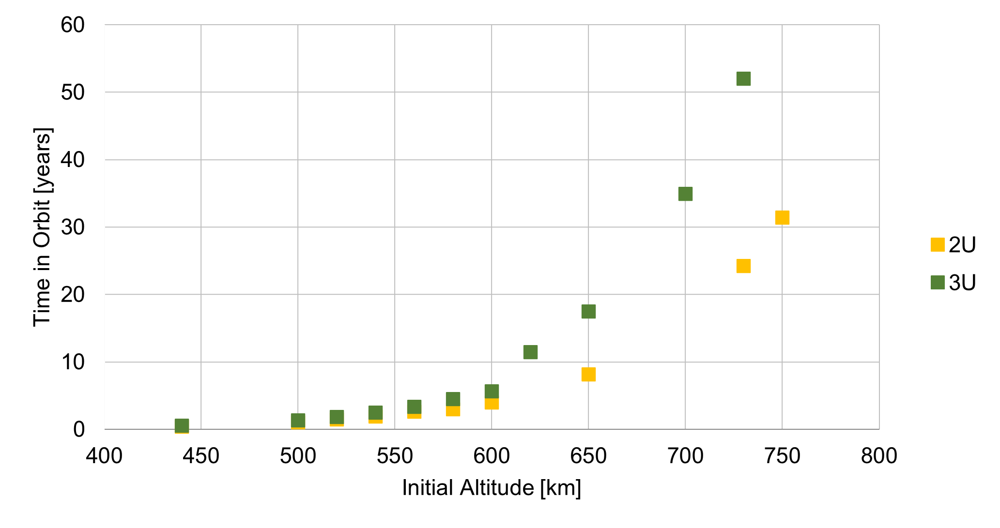
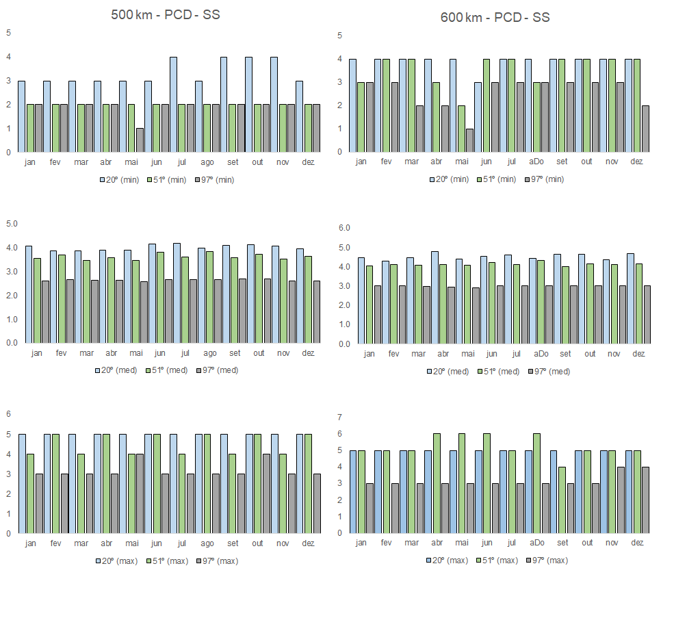
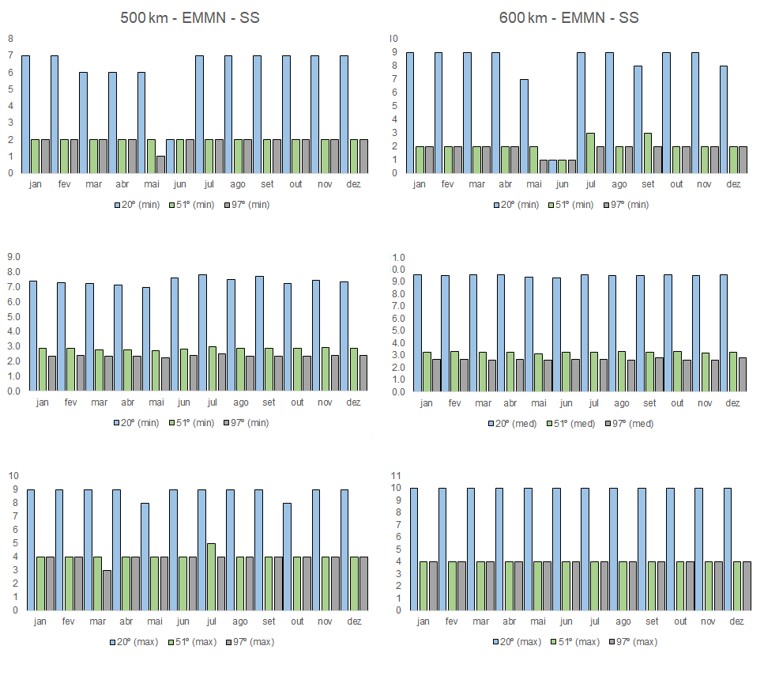
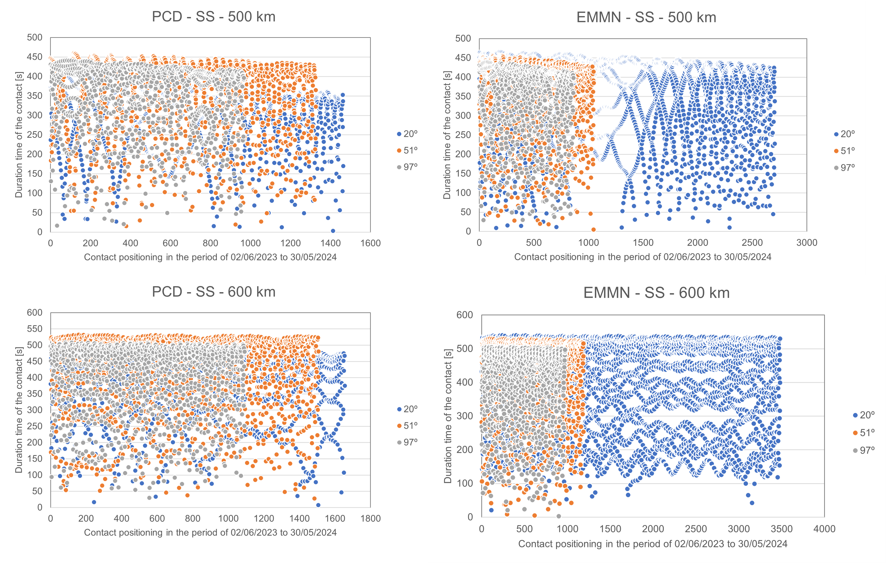
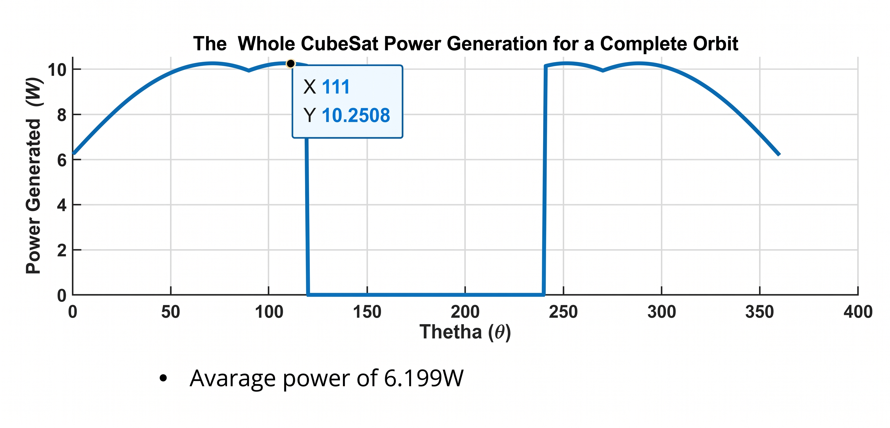
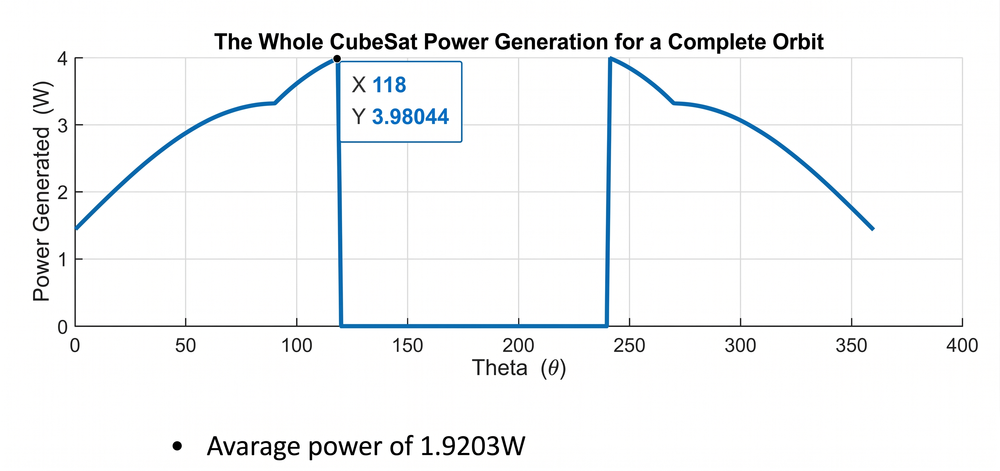
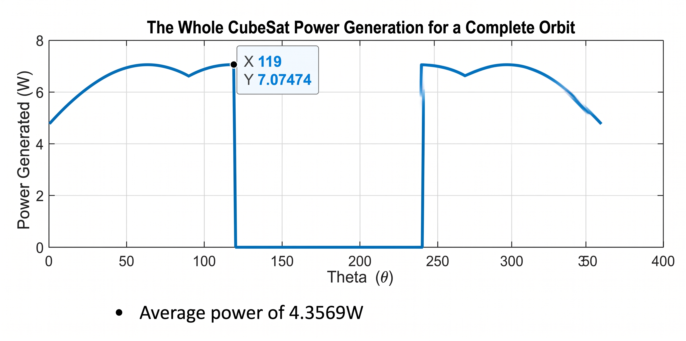

.. budgets.rst

    Copyright The Persistent-1 Contributors.

    Persistent-1 Documentation

    This work is licensed under the Creative Commons Attribution-ShareAlike 4.0
    International License. To view a copy of this license,
    visit http://creativecommons.org/licenses/by-sa/4.0/.

.. _ch:budgets:

**************************************
Technical Budgets and Mission Analysis
**************************************

This chapter presents the mission requirements and a general analysis of the mission, such as the satellite's estimated orbit, estimated lifetime, and the amount of data exchanged along its operation.

Another type of analysis presented is the satellite budgets, such as the mass, power and link budgets.

.. _sec:requirements:

Requirements
============

This section details the Persistent-1 requirements, divided into two main categories: interface requirements and technical requirements. In addition, there are subcategories that follow the nomenclature presented in :numref:`tab:req-abbreviations`, :numref:`tab:req-type1` and :numref:`tab:req-type2`.

.. _tab:req-abbreviations:

.. list-table:: Requirements abbreviations.
   :header-rows: 1

   * - **ID**
     - **Meaning**
   * - SLB-PRS-REQ-TYP1_TYP2_REQ<number>
     - Mission Requirements
   * - SLB-MEC-REQ-TYP1_TYP2_REQ<number>
     - Mechanical Requirements
   * - SLB-1U-REQ-TYP1_TYP2_REQ<number>
     - 1U Sector Requirements
   * - SLB-2U-REQ-TYP1_TYP2_REQ<number>
     - 2U Sector Requirements
   * - SLB-RE2PS-REQ-TYP1_TYP2_REQ<number>
     - RE²PS Requirements
   * - SLB-OBDH-REQ-TYP1_TYP2_REQ<number>
     - OBDH Requirements
   * - SLB-TMTC-REQ-TYP1_TYP2_REQ<number>
     - TMTC 3.0 Requirements

.. _tab:req-type1:

.. list-table:: Requirement type 1 (TYP1) codes.
   :header-rows: 1

   * - **Type 1**
     - **TYP1 Number**
   * - Mission
     - 0
   * - Functional
     - 1
   * - Physical
     - 2
   * - Environment
     - 3
   * - Operational
     - 4
   * - Interface
     - 5
   * - Design
     - 6
   * - Configuration
     - 7
   * - Human Factor
     - 8
   * - Logistics
     - 9
   * - Product Assurance
     - 10
   * - Verification
     - 11

.. _tab:req-type2:

.. list-table:: Requirement type 2 (TYP2) codes.
   :header-rows: 1

   * - **Type 2**
     - **TYP2 Number**
   * - Interface
     - 0
   * - Technical
     - 1

The requirements are also categorised by verification method, as detailed below:

* Testing;
* Demonstration;
* Inspection;
* Analysis.

The following sections detail the requirements, categorized by priority level (high and low).

High Level Requirements
-----------------------

Mission Requirements
~~~~~~~~~~~~~~~~~~~~

.. _tab:req-mission-requirements:

.. list-table:: Mission Requirements.
   :header-rows: 1
   :widths: 20 30 28 14 8

   * - ID
     - Description
     - Rationale
     - Parent Requirement
     - Verification
   * - SLB-PRS-REQ-1000
     - The satellite shall be compatible with the CubeSat standard
     - Ensures module compatibility with other satellites developed by SpaceLab
     - 
     - Inspection
   * - SLB-PRS-REQ-1200
     - The satellite must have interfaces for reprogramming the subsystems
     - So that the satellite can be easily accessed and programmed by the team
     - 
     - Inspection
   * - SLB-PRS-REQ-1201
     - The satellite must have interfaces for charging the battery, even integrated on the bench.
     - So that the satellite can be easily charged by the team
     - 
     - Inspection
   * - SLB-PRS-REQ-1202
     - The satellite must have an interface for using kill-switches and RBF
     - Ensures that the satellite is switched off during flight and switched on after the rocket deploys
     - 
     - Inspection
   * - SLB-PRS-REQ-1400
     - At least one ground station shall be used at UFSC
     - Ensures at least one ground station for acquiring data and sending remote commands to the satellite
     - 
     - Demonstration
   * - SLB-PRS-REQ-1401
     - At least one ground station should be used a world
     - Ensures at least one ground station for acquiring data and sending remote commands to the satellite
     - 
     - Demonstration
   * - SLB-PRS-REQ-1402
     - The satellite has to be able to receive commands and send telemetry in both sectors.
     - Ensures data acquisition and sending of remote controls to the satellite
     - 
     - Testing
   * - SLB-PRS-REQ-2000
     - The satellite shall be compatible with the CubeSat standard, following all the requirements of CDS :cite:`cds`
     - Ensures module compatibility with other satellites developed by SpaceLab
     - 
     - Inspection
   * - SLB-PRS-REQ-2001
     - The mission should last, at least, 24 months.
     - Defined by the team to validate the experiment
     - 
     - Inspection
   * - SLB-PRS-REQ-2002
     - The satellite has to be able to evaluate the RE²PS module operation
     - Ensure that the mission can be validated
     - 
     - Inspection
   * - SLB-PRS-REQ-2003
     - The CubeSats must be capable of operating in LEO at an altitude between 500 and 650 km and inclination above 30 degrees.
     - Defined by the team
     - 
     - Inspection
   * - SLB-PRS-REQ-2004
     - The satellite must be able to withstand the vibrations generated during launch.
     - Ensures that the satellite works after launch
     - 
     - Testing
   * - SLB-PRS-REQ-2005
     - The satellite has to be able to evaluate the SLCAM module operation
     - Ensure that the mission can be validated
     - 
     - Inspection
   * - SLB-PRS-REQ-2100
     - The satellite will have to collect information on the incidence of radiation (TID) throughout the experiment.
     - Defined by the team to validate the experiment
     - 
     - Testing
   * - SLB-PRS-REQ-2101
     - The satellite will have to collect information on the single event effect (SEE) throughout the experiment.
     - Defined by the team to validate the experiment
     - 
     - Testing
   * - SLB-PSR-RSK-2102
     - The service module and payload sectors must be independent with the exception of the communication bus interface and drives (energetically and functionally).
     - Defined by the team to ensure the successful operation of the mission
     - 
     - Testing
   * - SLB-PRS-REQ-2103
     - The satellite must be able to collect operations conditions and experiment data.
     - Ensure that the mission can be validated
     - 
     - Testing
   * - SLB-PRS-REQ-2104
     - The satellite must have a system to generate power and distribute to other subsystems.
     - Ensures that subsystems can be powered during operation
     - 
     - Testing
   * - SLB-PRS-REQ-2105
     - The satellite must automatically charge the batteries as long as there is excess energy available.
     - Ensures battery charging and therefore energy available for the subsystems
     - 
     - Testing
   * - SLB-PRS-REQ-2106
     - The satellite must be able to deliver the required subsystems voltages.
     - Ensures that subsystems can be powered during operation
     - 
     - Testing
   * - SLB-PRS-REQ-2107
     - The total area of the solar panels must supply enough energy to ensure the satellite's functionality throughout the worst-case scenario foreseen for the mission.
     - Ensures the survival of the modules, thus the survival of the satellite in space
     - 
     - Testing
   * - SLB-PRS-REQ-2200
     - The satellite must have some kind of radiation protection in structure.
     - Ensures that the satellite is more resistant to space radiation
     - 
     - Inspection
   * - SLB-PRS-REQ-2300
     - The antenna systems of the satellite shall operate within the temperature range of -20 to 60 °C :red:`TBC`
     - Defined by the team through orbital temperature information
     - 
     - Testing
   * - SLB-PRS-REQ-2301
     - The solar panels module of the satellite shall operate within the temperature range of -40 to 125 °C :red:`TBC`
     - Defined by the team through orbital temperature information
     - 
     - Testing
   * - SLB-PRS-REQ-2302
     - The EPS module of the satellite shall operate within the temperature range of -20 to 70 °C :red:`TBC`
     - Defined by the team through orbital temperature information
     - 
     - Testing
   * - SLB-PRS-REQ-2303
     - The OBDH module of the satellite shall operate within the temperature range of -25 to 65 °C :red:`TBC`
     - Defined by the team through orbital temperature information
     - 
     - Testing
   * - SLB-PRS-REQ-2304
     - The batteries of the satellite shall operate within the temperature range of 0° to 125 °C :red:`TBD`
     - Defined by the team through orbital temperature information
     - 
     - Testing
   * - SLB-PRS-REQ-2305
     - The communication systems of the satellite shall operate within the temperature range of -20 to 60 °C :red:`TBC`
     - Defined by the team through orbital temperature information
     - 
     - Testing
   * - SLB-PRS-REQ-2306
     - The structure of the satellite shall operate within the temperature range of -40 to 80 °C :red:`TBC`
     - Defined by the team through orbital temperature information
     - 
     - Testing
   * - SLB-PRS-REQ-2307
     - The satellite must withstand at least X rad/year.
     - Ensures experimental validation of the satellite
     - 
     - Analysis
   * - SLB-PRS-REQ-2400
     - The satellite must contain an operating mode to deal with detected faults.
     - Ensures the reliable operation of subsystems to prevent mission failure.
     - 
     - Testing
   * - SLB-PRS-REQ-2401
     - The satellite must have an operating mode to initialize all satellite modules.
     - Ensures that subsystems are initialized for proper satellite operation
     - 
     - Testing
   * - SLB-PRS-REQ-2402
     - The satellite must have a nominal operating mode to generate telemetry and conduct the experiment.
     - Ensures that the experiment can be conducted by the ground station
     - 
     - Testing
   * - SLB-PRS-REQ-2403
     - The satellite must have a low-power operating mode.
     - Ensures the satellite's operational longevity by balancing energy consumption with available resources.
     - 
     - Testing
   * - SLB-PRS-REQ-2600
     - The satellite must have a service module composed by an EPS 2.0, an OBDH 2.0, a TMTC 2.0 and a passive ACS
     - Defined by the team so that the satellite is functional and survives the mission
     - 
     - Inspection
   * - SLB-PRS-REQ-2601
     - The satellite must have a payload composed at least by an EPS, and OBDH, an TMTC more robust and reliable
     - Defined by the team to validate the experiment
     - 
     - Inspection

Low Level Requirements
----------------------

Mechanical Requirements
~~~~~~~~~~~~~~~~~~~~~~~

.. _tab:req-mechanical-requirements:

.. list-table:: Mechanical Requirements.
   :header-rows: 1
   :widths: 20 30 28 14 8

   * - ID
     - Description
     - Rationale
     - Parent Requirement
     - Verification
   * - SLB-MEC-REQ-2700
     - The satellite must contain a form of radiation mitigation through :red:`TBC` (type of metal) aluminum plates :red:`TBC`\ mm thick that surround the entire structure.
     - Ensures that the satellite is more resistant to space radiation
     - SLB-PRS-REQ-2200
     - Inspection

1U Sector Requirements
~~~~~~~~~~~~~~~~~~~~~~

.. _tab:req-1u-sector-requirements:

.. list-table:: 1U Sector Requirements.
   :header-rows: 1
   :widths: 20 30 28 14 8

   * - ID
     - Description
     - Rationale
     - Parent Requirement
     - Verification
   * - SLB-1U-REQ-1100
     - OBDH must have access to the RE²PS converter enables in order to disable them.
     - Defined by the team
     - 
     - Testing
   * - SLB-1U-REQ-1101
     - The OBDH must have access to OBDH to collect data.
     - Defined by the team
     - 
     - Testing
   * - SLB-1U-REQ-1500
     - There must be an interface between the OBDH and the EPS for communication.
     - Ensures that temperature, voltage and current data from the EPS and battery are read by the OBDH
     - 
     - Inspection
   * - SLB-1U-REQ-1502
     - There must be an interface between the OBDH and the TTC for communication.
     - Ensures that the TTC's temperature, voltage and current data are read by the OBDH
     - 
     - Inspection
   * - SLB-1U-REQ-1503
     - The EPS must be able to interface with the panels.
     - Ensures the purchase of energy from solar panels
     - SLB-PRS-REQ-2104
     - Inspection
   * - SLB-1U-REQ-1504
     - There must be an interface between the EPS and the batteries for management and control.
     - Ensures reliable battery operation through constant monitoring and failure prevention
     - SLB-PRS-REQ-2104
     - Inspection
   * - SLB-1U-REQ-1505
     - There must be an interface between the TTC and the antenna for receiving or transmitting data.
     - Supports continuous telemetry and telecommand exchange between the satellite and ground station
     - SLB-PRS-REQ-1402
     - Inspection
   * - SLB-1U-REQ-1506
     - The EPS must have power interfaces to supply the OBDH, TTC and other equipment in the sector.
     - Ensures that subsystems are operating
     - SLB-PRS-REQ-2106
     - Inspection
   * - SLB-1U-REQ-1600
     - All interfaces between the subsystems in the service module sector must be made via flight heritage connectors.
     - Ensures greater reliability for satellite cabling
     - 
     - Inspection
   * - SLB-1U-REQ-2400
     - The antenna must be able to operate on the :red:`TBC` MHz frequency in a turnstile configuration.
     - Defined by the team
     - 
     - Testing
   * - SLB-1U-REQ-2401
     - The OBDH must not consume 250mW considering the Duty Cycle
     - Defined by the team based on power
     - 
     - Testing
   * - SLB-1U-REQ-2402
     - The EPS must not consume 410mW considering the Duty Cycle
     - Defined by the team based on power
     - 
     - Testing
   * - SLB-1U-REQ-2403
     - The TTC must not consume 500mW considering the Duty Cycle
     - Defined by the team based on power
     - 
     - Testing
   * - SLB-1U-REQ-2700
     - The service module sector shall have an independent antenna.
     - Defined by the team
     - 
     - Inspection
   * - SLB-1U-REQ-2701
     - The OBDH cannot have 5% of the satellite's mass considering the 5% contingency margin and a variable margin of error according to its TRL.
     - Defined by the team based on the mass budget
     - 
     - Analysis
   * - SLB-1U-REQ-2702
     - The EPS cannot have 5% of the satellite's mass considering the 5% contingency margin and a variable margin of error according to its TRL.
     - Defined by the team based on the mass budget
     - 
     - Analysis
   * - SLB-1U-REQ-2703
     - The TTC cannot have 5% of the satellite's mass considering the 5% contingency margin and a variable margin of error according to its TRL.
     - Defined by the team based on the mass budget
     - 
     - Analysis

2U Sector Requirements
~~~~~~~~~~~~~~~~~~~~~~

.. _tab:req-2u-sector-requirements:

.. list-table:: 2U Sector Requirements.
   :header-rows: 1
   :widths: 20 30 28 14 8

   * - ID
     - Description
     - Rationale
     - Parent Requirement
     - Verification
   * - SLB-2U-REQ-1100
     - OBDH must have access to the RE²PS converter enables in order to disable them.
     - Defined by the team
     - 
     - Testing
   * - SLB-2U-REQ-1500
     - There must be an interface between the OBDH and the RE²PS for communication.
     - Ensures that temperature, voltage and current data from the EPS and battery are read by the OBDH
     - 
     - Testing
   * - SLB-2U-REQ-1502
     - There must be an interface between the OBDH and the TMTC for communication.
     - Ensures that the TTC's temperature, voltage and current data are read by the OBDH
     - 
     - Inspection
   * - SLB-2U-REQ-1503
     - The RE²PS must be able to interface with the panels.
     - Ensures the purchase of energy from solar panels
     - SLB-PRS-REQ-2104
     - Inspection
   * - SLB-2U-REQ-1504
     - There must be an interface between the RE²PS and the batteries for management and control.
     - Ensures reliable battery operation through constant monitoring and failure prevention
     - SLB-PRS-REQ-2104
     - Inspection
   * - SLB-2U-REQ-1505
     - There must be an interface between the TMTC and the antenna for receiving or transmitting data.
     - Supports continuous telemetry and telecommand exchange between the satellite and ground station
     - SLB-PRS-REQ-1402
     - Inspection
   * - SLB-2U-REQ-1506
     - The RE²PS must have power interfaces to supply the OBDH, TMTC and other equipment in the sector.
     - Ensures that subsystems are operating
     - SLB-PRS-REQ-2106
     - Inspection
   * - SLB-2U-REQ-1600
     - All interfaces between the subsystems in the service module sector must be made via flight heritage connectors.
     - Ensures greater reliability for satellite cabling
     - 
     - Inspection
   * - SLB-2U-REQ-2400
     - The antenna must be able to operate on the :red:`TBC` MHz frequency in a turnstile configuration.
     - Defined by the team
     - 
     - Inspection
   * - SLB-2U-REQ-2401
     - The OBDH must not consume 800mW considering the Duty Cycle
     - Defined by the team based on power
     - 
     - Testing
   * - SLB-2U-REQ-2402
     - The RE²PS must not consume 410mW considering the Duty Cycle
     - Defined by the team based on power
     - 
     - Testing
   * - SLB-2U-REQ-2403
     - The TMTC must not consume 500mW considering the Duty Cycle
     - Defined by the team based on power
     - 
     - Testing
   * - SLB-2U-REQ-2700
     - The service module sector shall have an independent antenna.
     - Defined by the team
     - 
     - Testing
   * - SLB-2U-REQ-2700
     - The service module sector shall have an independent antenna.
     - Defined by the team
     - 
     - Inspection
   * - SLB-2U-REQ-2701
     - The OBDH cannot have 5% of the satellite's mass considering the 5% contingency margin and a variable margin of error according to its TRL.
     - Defined by the team based on the mass budget
     - 
     - Analysis
   * - SLB-2U-REQ-2702
     - The RE²PS cannot have 5% of the satellite's mass considering the 5% contingency margin and a variable margin of error according to its TRL.
     - Defined by the team based on the mass budget
     - 
     - Analysis
   * - SLB-2U-REQ-2703
     - The TMTC cannot have 5% of the satellite's mass considering the 5% contingency margin and a variable margin of error according to its TRL.
     - Defined by the team based on the mass budget
     - 
     - Analysis

Reliability Enhance Electrical Power System Requirements
~~~~~~~~~~~~~~~~~~~~~~~~~~~~~~~~~~~~~~~~~~~~~~~~~~~~~~~~

.. _tab:req-reliability-enhance-electrical-power-system-requirements-requirements:

.. list-table:: Reliability Enhance Electrical Power System Requirements.
   :header-rows: 1
   :widths: 20 30 28 14 8

   * - ID
     - Description
     - Rationale
     - Parent Requirement
     - Verification
   * - SLB-RE2PS-REQ-1100
     - RE²PS must allow access to OBDH and OBDH in order to be disabled converters enable by each of these subsystems
     - So that RE²PS can be controlled easily
     - SLB-1U-REQ-1100, SLB-2U-REQ-1100
     - Testing
   * - SLB-RE2PS-REQ-1600
     - The RE²PS must interface via connectors with flight heritage.
     - Ensures greater reliability for satellite cabling
     - SLB-2U-REQ-1600
     - Inspection

On-Boarding Data Handling - 2U Requirements
~~~~~~~~~~~~~~~~~~~~~~~~~~~~~~~~~~~~~~~~~~~

.. _tab:req-on-boarding-data-handling-2u-requirements:

.. list-table:: On-Boarding Data Handling - 2U Requirements.
   :header-rows: 1
   :widths: 20 30 28 14 8

   * - ID
     - Description
     - Rationale
     - Parent Requirement
     - Verification
   * - SLB-OBDH-REQ-1100
     - OBDH must have access to the RE²PS converter enabled in order to disable them.
     - So that RE²PS can be controlled easily, since it doesn't have a microcontroller
     - SLB-2U-REQ-1100, SLB-RE2PS-REQ-1100
     - Testing
   * - SLB-OBDH-REQ-1600
     - OBDH must interface via connectors with flight heritage.
     - Ensures greater reliability for satellite cabling
     - SLB-2U-REQ-1600
     - Inspection
   * - SLB-OBDH-REQ-2100
     - OBDH must control the heaters so that the battery stays between the operating temperatures.
     - Implements thermal management strategies to ensure payload battery operation within the defined temperature envelope, mitigating the risk of thermal runaway or performance degradation
     - SLB-PRS-REQ-2304
     - Inspection
   * - SLB-OBDH-REQ-2600
     - OBDH must have a dosimeter to measure radiation
     - Ensures experimental validation of radiation
     - SLB-PRS-REQ-2307, SLB-PRS-REQ-2002
     - Inspection
   * - SLB-OBDH-REQ-2601
     - OBDH must have the means to detect random faults
     - Ensures experimental validation of radiation
     - SLB-PRS-REQ-2400, SLB-PRS-REQ-2002
     - Inspection
   * - SLB-OBDH-REQ-2602
     - OBDH must be able to perform image processing.
     - Ensures experimental validation of images for SLCAM
     - SLB-PRS-REQ-2005
     - Inspection

Telemetry and Telecommand Requirements
~~~~~~~~~~~~~~~~~~~~~~~~~~~~~~~~~~~~~~

.. list-table:: Telemetry and Telecommand Requirements

   * - SLB-TMTC-REQ-1600
     - TMTC must interface via connectors with flight heritage.
     - Ensures greater reliability for satellite cabling
     - SLB-2U-REQ-1600
     - Inspection

Orbit Parameters and Analysis
=============================

The following analyses were carried out using the GMAT tools, as well as orbit analysis software developed in-house.

:numref:`graphdecorbit` shows the decay data resulting from simulations developed for different initial orbit altitudes and an inclination of 30°.

.. _graphdecorbit:

   Fleet A's space systems orbit decay analysis.

It is verified that once the chosen orbit is smaller than 650km, the maximum possible lifetime requirement from the standard :cite:`SpaceDebrisStandard` will be met. For an orbit of 500 km a lifetime in orbit estimated for a 2U is 1.02 years while for a 3U is 1.3 years. Thus the lifetime of the Catarina-A1 for a 500 km orbit is estimated in 1.02 years.

.. _sec:orbital_needs:

Orbital needs for communication with DCP and ground station
-----------------------------------------------------------

.. _sec:operation_altitude:

Operation altitude
~~~~~~~~~~~~~~~~~~

Operating altitude is set to occur in LEO. Within this scenario, the maximum and minimum operating altitudes of the Catarina-A1 estimated herein are 600 km and 500 km. The 600 km limit is to respect the Space Debris Mitigation Guidelines standard :cite:`SpaceDebrisStandard` to ensure the space system stays in orbit for less than 25 years while the 500 km limit is the expected orbit altitude for the possible launch being analized for Catarina-A1.

.. _sec:orbit_inclination:

Orbit inclination
~~~~~~~~~~~~~~~~~

The inclination of the orbit has the limitation of allowing the Catarina-A1 nanosatellite to communicate with both the DCP installed in SC and the EMMN on a recurring basis during its operation. In this sense, the orbit range was limited between 20° and approximately 97° (Sun Syncronous Orbit). For orbit inclinations lower than 20° the communication between the space system and the DCP at Santa Catarina is not viable as can be seen in later sections of this document.

.. _sec:communication_perday_pcd:

Number of communication per day: SS - DCP
^^^^^^^^^^^^^^^^^^^^^^^^^^^^^^^^^^^^^^^^^

The number of times the Catarina-A1 has contact with the DCP at Santa Catarina is indicated below for the orbit inclination of 20°, 51° and 97°, for the altitudes of 500 km and 600 km. Data is presented in different graphs for the minimum number of contacts per day in the month, average number of contacts per day in the month, and maximum number of contacts per day in the month. The average period of each contact is 312 seconds, with a minimum of 30 seconds and a maximum of 410 seconds for all cases analyzed here. Simulations were conducted for the period of 01/06/2023 to 31/05/2024. Since the estimated date for the launch is March 2025, simulations will be updated for the expected date however no significant variations in the presented data is expected.

.. _communication_perday_pcd:

   DCP-SS communication number of times per day per month from 01/06/2023 to 31/05/2024 for altitudes of 500 km (left) and 600 km (right). From top to bottom: Minimum number, average number, and maximum number.

As can be noted, the minimum number of contacts per day for all configurations is 1. As an example, for an altitude of 500 km and inclination of 97°, in May 2024 at least one day will have only one contact point between DCP and the space system. For the same inclinations, all other months will have at least 2 contacts per day. The average contact number is between 2 to 3 (for 97°), 3 to 4 (for 51°), and 3 to 4 (for 20°). All simulations were carried out with a contact angle of 10º.

.. _sec:communication_perday_emmn:

Number of communication per day: SS - EMMN
^^^^^^^^^^^^^^^^^^^^^^^^^^^^^^^^^^^^^^^^^^

The same analysis is presented below for the contact point between the space system and the ground station at Natal. Here we can see that the inclination of 20° has a much higher number of contact points per day than the other inclinations. However, the minimum contact number for all inclinations and altitudes considered herein is still 1, at least one day in May 2024 and June 2023.

.. _communication_perday_emmn:

   EMMN-SS communication number of times per day per month from 01/06/2023 to 31/05/2024 for altitudes of 500 km (left) and 600 km (right). From top to bottom: Minimum number, average number, and maximum number.

.. _sec:transmission_time:

Transmission time
~~~~~~~~~~~~~~~~~

To evaluate the duration of the communication at each contact point between the space system and the ground station or space system and DCP the duration of the communication in each contact is presented below.

.. _sec:communication_time:

Communication time
^^^^^^^^^^^^^^^^^^

The figure below plots the occurrence of each contact point for the altitudes of 500 km and 600 km for the three inclinations analyzed versus the duration of the contact point. On the top-left plot, we can see the duration and the total number of contact points for 500 km for each inclination between DCP and the space system. For example, for the inclination of 20°, a total of approximately 1440 contact points were estimated through the period of 02/06/2023 to 30/05/2024. Of these 1440 contacts, only 12 contacts had a duration under 50 seconds. Most contacts for all inclinations and altitudes analyzed are concentrated over 200 seconds.

.. _communication_time:

   Communication time from 02/06/2023 to 30/05/2024 for altitudes of 500 km (left) and 600 km (right).

Results indicate that all three orbits analyzed herein can guarantee a minimum contact point between the space system and DCP and ground station of at least 1 per day in the worst-case scenario, indicating that the orbit of 20°, 51°, and 97° can be used to complete the mission.

However, it is interesting to notice that the orbit inclination of 20° has a much higher number of average contact points for both configurations (space system-DCP and space system-GS) and would be a possible good choice for the baseline orbit, based on the parameters analyzed up to this point. Notice that the possible launch for Catarina-A1 is expected to be in a Sun Synchronous Orbit or 43°, both at 500 km. For this launch condition, communication contacts and time for the Ground Station-SS and SS-DCP are expected to be similar to the ones presented for the 97° and the 51°.

For the altitude, similar results for contact points and duration of contact were encountered except for the configuration of 20° and 600 km which resulted in an elevated number of total contact points for the space system and the ground station.

.. _mass-budget:

Mass Budget
===========

The CubeSat standard establishes a weight limit of 2 kg for a 1U CubeSat :cite:`cds` implying limits of 4 kg and 6 kg for 2U and 3U CubeSats, respectively. However, not all launch providers adhere to these standards, necessitating the consideration of more restrictive scenarios.

Below, we present a mass budget analysis for the Persistent-1 satellite, considering both 2U and 3U configurations. For the most restrictive scenario, the limits of 2.66 kg and 4 kg for 2U and 3U, respectively, are assumed.

Initially, we detail in :numref:`tab:mass-budget` the mass budget for the 1U and 2U subsystems, common to both configurations. Then, we present the mass budget for the remaining subsystems in :numref:`tab:mass-budget-2u` (2U) and :numref:`tab:mass-budget-3u` (3U).

The analysis reveals that, considering the 3U configuration and the most restrictive mass limits, Persistent-1 falls within the allowed limits, exhibiting a margin ranging from 36.48% to 46.14%.

.. _tab:mass-budget:

.. list-table:: Mass budget of Persistent-1 - Service and Payload Sector
   :header-rows: 1

   * - **Subsystem**
     - **Supplier**
     - **Model**
     - **Mass [g]**
     - **Margin [%]**
     - **Final mass [g]¹**
   * - *OBDH* 2.0
     - SpaceLab
     - *OBDH* 2.0
     - 53
     - 5
     - 55.65
   * - *TTC* 2.0
     - SpaceLab
     - *TTC* 2.0
     - 73
     - 5
     - 76.65
   * - *EPS* 2.0
     - SpaceLab
     - *EPS* 2.0
     - 90
     - 5
     - 94.5
   * - Battery board
     - SpaceLab
     - *BAT4C*
     - 235
     - 15
     - 270.25
   * - *TTC*\ ’s antenna
     - ISISpace
     - AntS
     - 89
     - 5
     - 93.45
   * - *ACS*
     - SpaceLab
     - Passive *ACS*
     - 52
     - 15
     - 59.8
   * - 1st Payload
     - INPE
     - *EDC/Explora*
     - 75
     - 15
     - 86.25
   * - 2nd Payload
     - SpaceLab
     - *RE²PS*
     - 65
     - 15
     - 74.75
   * - 3rd Payload
     - SpaceLab
     - *SLCAM*
     - 68
     - 15
     - 78.2
   * - *TTC 2.0*
     - SpaceLab
     - *TTC 2.0*
     - 73
     - 5
     - 55.65
   * - *OBDH 2.0*
     - SpaceLab
     - *OBDH 2.0*
     - 53
     - 5
     - 55.65
   * - *TTC*\ ’s antenna
     - ISISpace
     - AntS
     - 89
     - 5
     - 93.45
   * - Battery board
     - SpaceLab
     - *BAT4C*
     - 235.00
     - 15
     - 270.25
   * - **Total**
     - 
     - 
     - 1250.00
     - 
     - 1385.50
   * - ¹ values obtained after considering the mass margins.
     - 
     - 
     - 
     - 
     - 

.. _tab:mass-budget-2u:

.. list-table:: Mass budget of Persistent-1 - 2U
   :header-rows: 1

   * - **Subsystem**
     - **Supplier**
     - **Model**
     - **Mass [g]**
     - **Margin [%]**
     - **Final mass [g]¹**
   * - Interface boards
     - SpaceLab
     - Interface boards
     - 40
     - 5
     - 42
   * - PC-104 adapters
     - SpaceLab
     - Adapter boards
     - 62
     - 5
     - 65.1
   * - Solar panels
     - Orbital
     - Solar panels
     - 266
     - 15
     - 305.9
   * - Shields
     - Usiped
     - Aluminum sheets
     - 503
     - 15
     - 578.45
   * - Structure
     - Usiped
     - Structure
     - 206
     - 15
     - 236.9
   * - Cables
     - -
     - -
     - 200
     - 15
     - 230
   * - Others
     - -
     - -
     - 100
     - 15
     - 115
   * - **Total²**
     - 
     - 
     - 2671
     - 
     - 3166.55
   * - **Maximum**
     - 
     - 
     - 4000
     - 
     - 4000
   * - **Margin**
     - 
     - 
     - 33.23%
     - 
     - 20.84%
   * - ¹ values obtained after considering the mass margins.
     - 
     - 
     - 
     - 
     - 
   * - ² Values obtained from the sum of the “Total” of :numref:`tab:mass-budget` with the “Final mass” of each subsystem of :numref:`tab:mass-budget-2u`
     - 
     - 
     - 
     - 
     - 

.. _tab:mass-budget-3u:

.. list-table:: Mass budget of Persistent-1 - 3U
   :header-rows: 1

   * - **Subsystem**
     - **Supplier**
     - **Model**
     - **Mass [g]**
     - **Margin [%]**
     - **Final mass [g]¹**
   * - Interface boards
     - SpaceLab
     - Interface boards
     - 40
     - 5
     - 42
   * - PC-104 adapters
     - SpaceLab
     - Adapter boards
     - 62
     - 5
     - 65.1
   * - Solar panels
     - Orbital
     - Solar panels
     - 372.4
     - 15
     - 429.26
   * - Shields
     - Usiped
     - Aluminum sheets
     - 704.2
     - 15
     - 809.83
   * - Structure
     - Usiped
     - Structure
     - 309
     - 15
     - 355.35
   * - Cables
     - -
     - -
     - 300
     - 15
     - 345
   * - Others
     - -
     - -
     - 150
     - 15
     - 172.5
   * - **Total²**
     - 
     - 
     - 3231.6
     - 
     - 3811.24
   * - **Maximum**
     - 
     - 
     - 6000
     - 
     - 6000
   * - **Margin**
     - 
     - 
     - 46.14%
     - 
     - 36.48%
   * - ¹ values obtained after considering the mass margins.
     - 
     - 
     - 
     - 
     - 
   * - ² Values obtained from the sum of the “Total” of :numref:`tab:mass-budget` with the “Final mass” of each subsystem of :numref:`tab:mass-budget-3u`
     - 
     - 
     - 
     - 
     - 

.. _sec:power:

Power Budget
============

Following Section 10.3 of :cite:`larson2005`, the power budget is established in three steps:

#. Estimate the satellite's power generation and consumption;

#. Size the battery;

#. Evaluate the degradation of the power system over the mission's lifetime.

The first step checks whether the energy generated is sufficient to supply the satellite's loads. The second step evaluates the selected battery capacity and the energy available for recharge. Finally, the degradation analysis examines how the energy balance changes over the mission.

Persistent-1 is a 3U CubeSat composed of a 1U sector and a 2U sector. The power generation, consumption and battery sizing are evaluated separately for these sectors. The 1U sector includes EPS 2.0 and EDC/Explora, while the 2U sector includes the RE²PS and SLCAM. Each sector has its own BAT4C board, allowing the loading of the two batteries to be assessed independently.

Input Power
-----------

.. _fig:sp_sim_power:

.. _fig:maximum_eclipse_3u:

   Simulated input power of the solar panels in the maximum-eclipse case, for the complete 3U spacecraft and its 1U and 2U sectors. (3U spacecraft)

.. _fig:maximum_eclipse_1u:

   Simulated input power of the solar panels in the maximum-eclipse case, for the complete 3U spacecraft and its 1U and 2U sectors. (1U sector)

.. _fig:maximum_eclipse_2u:

   Simulated input power of the solar panels in the maximum-eclipse case, for the complete 3U spacecraft and its 1U and 2U sectors. (2U sector)

The simulation figures present the solar-panel power generation over an orbit with maximum eclipse. :numref:`fig:maximum_eclipse_3u` shows the complete spacecraft, and :numref:`fig:maximum_eclipse_1u` and :numref:`fig:maximum_eclipse_2u` show the two sectors considered in the power budget. The sector results are used to evaluate the energy available to each battery board.

:numref:`tab:power-simulations-1u` and :numref:`tab:power-simulations-2u` summarize the orbit-average power and solar energy at beginning of life (BOL), as reported in the supplied power-budget data. These values are used in the following analysis.

.. _tab:power-simulations-1u:

.. list-table:: Results for the power input of the Persistent-1 1U sector.
   :header-rows: 1

   * - **Parameter**
     - **Variable**
     - **BOL value**
   * - Orbit Average Power [mW]
     - :math:`P_{OAP,1U}`
     - 3980.00
   * - Solar energy per orbit [mWh]
     - :math:`E_{OAP,1U}`
     - 5023.644444

.. _tab:power-simulations-2u:

.. list-table:: Results for the power input of the Persistent-1 2U sector.
   :header-rows: 1

   * - **Parameter**
     - **Variable**
     - **BOL value**
   * - Orbit Average Power [mW]
     - :math:`P_{OAP,2U}`
     - 4279.20
   * - Solar energy per orbit [mWh]
     - :math:`E_{OAP,2U}`
     - 5407.957867

Operating Power Budget
----------------------

The typical power consumption of each subsystem is combined with its operating duty cycle and margin to obtain the power budget. :numref:`tab:power-budget-1u` and :numref:`tab:power-budget-2u` present these values for the two sectors. TTC 2.0 is considered to transmit during 5% of the operating period; battery heating is allocated 10%. In the 1U sector, EDC/Explora is allocated 30%. In the 2U sector, SLCAM remains idle for 90% and acquires images for 10% of the period. Antenna deployment has a zero duty cycle in the recurring orbital budget.

The estimated power requirement, denoted by :math:`P_{sat}`, is **1972.1 mW for the 1U sector** and **1799.9 mW for the 2U sector**. The energy consumed over an orbit is expressed as

.. math::
   :label: eq:satellite-energy-consumption

   E_{sat,k}=P_{sat,k}\,T,\qquad k\in\{1U,2U\}.

Here :math:`E_{sat,k}` is the energy required by sector :math:`k`, :math:`P_{sat,k}` is its estimated power requirement, and :math:`T` is the orbital period, expressed in hours when energy is given in mWh.

.. _tab:power-budget-1u:

.. list-table:: Power budget of the Persistent-1 1U sector.
   :header-rows: 1

   * - **Subsystem**
     - **Duty cycle [%]**
     - **Typ. power consumption [mW]**
     - **Margin [%]**
     - **Max. power consumption [mW]**\ ¹
   * - OBDH 2.0
     - 100
     - 115.5
     - 5
     - 121.275
   * - TTC 2.0 (not transmitting)
     - 95
     - 165.66
     - 5
     - 165.24585
   * - TTC 2.0 (transmitting)
     - 5
     - 3251
     - 5
     - 170.6775
   * - EPS 2.0
     - 100
     - 370
     - 5
     - 388
   * - BAT4C (idle)
     - 90
     - 0
     - 5
     - 0
   * - BAT4C (heater operating)
     - 10
     - 5002.4
     - 5
     - 525.252
   * - AntS (deploying)
     - 0
     - 1815
     - 5
     - 0
   * - AntS (deployed)
     - 100
     - 198
     - 5
     - 207.9
   * - EDC/Explora
     - 30
     - 1250
     - 5
     - 393.75
   * - **Total [mW]**
     - 
     - 
     - 
     - 1972.1
   * - **Total [mWh]**\ ²
     - 
     - 
     - 
     - 3111.536108
   * - **Maximum [mWh]**\ ³
     - 
     - 
     - 
     - 5023.644444
   * - **Margin [mWh]**
     - 
     - 
     - 
     - 1912.108337
   * - **Margin [%]**
     - 
     - 
     - 
     - 38.06

.. _tab:power-budget-2u:

.. list-table:: Power budget of the Persistent-1 2U sector.
   :header-rows: 1

   * - **Subsystem**
     - **Duty cycle [%]**
     - **Typ. power consumption [mW]**
     - **Margin [%]**
     - **Max. power consumption [mW]**\ ¹
   * - OBDH 2.0
     - 100
     - 115.5
     - 5
     - 121.275
   * - TTC 2.0 (not transmitting)
     - 95
     - 165.66
     - 5
     - 165.24585
   * - TTC 2.0 (transmitting)
     - 5
     - 3251
     - 5
     - 170.6775
   * - BAT4C (idle)
     - 90
     - 0
     - 5
     - 0
   * - BAT4C (heater operating)
     - 10
     - 5002.4
     - 5
     - 525.252
   * - RE²PS
     - 100
     - 370
     - 15
     - 425.5
   * - SLCAM (idle)
     - 90
     - 100
     - 15
     - 103.5
   * - SLCAM (acquiring images)
     - 10
     - 700
     - 15
     - 80.5
   * - AntS (deploying)
     - 0
     - 1815
     - 5
     - 0
   * - AntS (deployed)
     - 100
     - 198
     - 5
     - 207.9
   * - **Total [mW]**
     - 
     - 
     - 
     - 1799.9
   * - **Total [mWh]**\ ²
     - 
     - 
     - 
     - 2843.263595
   * - **Maximum [mWh]**\ ³
     - 
     - 
     - 
     - 5407.957867
   * - **Margin [mWh]**
     - 
     - 
     - 
     - 2564.694272
   * - **Margin [%]**
     - 
     - 
     - 
     - 47.42

The orbital energy consumption reported for 1U is **3111.54 mWh**. For 2U, it is **2843.26 mWh**. The energy generated by the PV panels is evaluated using the orbit-average power and the harvesting efficiency:

.. math::
   :label: eq:oap-energy

   E_{OAP,k}=(P_{OAP,k}\,\eta)\,(T_E+T_S).

Here :math:`E_{OAP,k}` is the available solar energy per orbit, :math:`P_{OAP,k}` is the orbit-average solar power, :math:`\eta` is the energy-harvesting efficiency, and :math:`T_E` and :math:`T_S` are the eclipse and sunlight durations. An efficiency of 80% is retained from the adopted budget.

The available solar energy is **5023.64 mWh for 1U** and **5407.96 mWh for 2U**. Therefore, the reported energy margins are **1912.11 mWh (38.06%) for 1U** and **2564.69 mWh (47.42%) for 2U**. Both sectors present a positive orbital energy balance at BOL. The percentage margin is referenced to the available solar energy of the corresponding sector.

Battery Sizing
--------------

As described in :cite:`larson2005`, battery sizing considers the power required by the satellite, the charge and discharge periods, the depth of discharge (DoD), and the energy available for recharge. These steps are applied to each sector of Persistent-1. The discharge period corresponds to eclipse, while the recharge interval corresponds to sunlight.

One BAT4C board is considered for each sector. Each board supports four cells in a 2S2P configuration, with nominal cell values of 3.6 V and 2500 mAh, resulting in a nominal energy capacity of 36000 mWh per board. The adopted discharge period is 0.592 h. The DoD is given by

.. math::
   :label: eq:dod-equation

   DoD_k=\frac{D_{i,k}\,D_t}{C_k}\,100,

where :math:`D_{i,k}` is the discharge power of sector :math:`k`, :math:`D_t` is the discharge period, and :math:`C_k` is the battery energy capacity. For this estimate, :math:`D_{i,k}=P_{sat,k}` and :math:`D_t=T_E`.

Using the power requirement of each sector gives

.. math::

   \begin{aligned}
   DoD_{1U}&=\frac{1972.1\times0.592}{(2\times3.6)(2\times2500)}\,100
   \approx3.24\%,\\
   DoD_{2U}&=\frac{1799.9\times0.592}{(2\times3.6)(2\times2500)}\,100
   \approx2.96\%.
   \end{aligned}

Both values are below the preliminary 30% DoD criterion adopted in this analysis. Each battery board is evaluated independently. The legacy 6.22% and 12.45% values in the supplied sizing blocks use a discharge power of 3784.2 mW and are not the DoD calculated from these sector loads.

The energy available for recharge during sunlight is obtained by subtracting the sunlight load from the orbital solar-energy total. Using the sunlight consumption reported in the supplied sizing data gives

.. math::

   \begin{aligned}
   E_{sun,1U}&=5023.644444-1939.2\approx3084.44~\mathrm{mWh},\\
   E_{sun,2U}&=5407.957867-1773.4\approx3634.56~\mathrm{mWh}.
   \end{aligned}

The reported eclipse consumption is 1172.3 mWh for 1U and 1069.9 mWh for 2U. Consequently, the energy remaining after replenishing the eclipse consumption is

.. math::

   \begin{aligned}
   \Delta E_{bat,1U}&=3084.44-1172.3\approx1912.14~\mathrm{mWh},\\
   \Delta E_{bat,2U}&=3634.56-1069.9\approx2564.66~\mathrm{mWh}.
   \end{aligned}

These positive margins agree with the orbital budget within the rounding of the sunlight and eclipse values. :numref:`tab:battery-sizing-results-1u` and :numref:`tab:battery-sizing-results-2u` summarize the battery sizing for each sector. The separate solar-energy entries of 2406.9 and 5374.2 mWh in the supplied battery blocks differ from the orbital budget and require reconciliation; the recharge calculation above consistently uses the main budget totals.

.. _tab:battery-sizing-results-1u:

.. list-table:: Battery sizing results for the Persistent-1 1U sector.
   :header-rows: 1

   * - **Parameter**
     - **Value**
     - **Unit**
   * - Battery capacity
     - 36000
     - mWh
   * - Discharge period
     - 0.592
     - h
   * - Depth of Discharge (DoD)
     - 3.24
     - %
   * - Energy generated by the PV panels
     - 5023.64
     - mWh
   * - Energy consumption in sunlight
     - 1939.2
     - mWh
   * - Energy available for recharge
     - 3084.44
     - mWh
   * - Energy consumption during eclipse
     - 1172.3
     - mWh
   * - **Total battery energy margin**
     - 1912.14
     - mWh

.. _tab:battery-sizing-results-2u:

.. list-table:: Battery sizing results for the Persistent-1 2U sector.
   :header-rows: 1

   * - **Parameter**
     - **Value**
     - **Unit**
   * - Battery capacity
     - 36000
     - mWh
   * - Discharge period
     - 0.592
     - h
   * - Depth of Discharge (DoD)
     - 2.96
     - %
   * - Energy generated by the PV panels
     - 5407.96
     - mWh
   * - Energy consumption in sunlight
     - 1773.4
     - mWh
   * - Energy available for recharge
     - 3634.56
     - mWh
   * - Energy consumption during eclipse
     - 1069.9
     - mWh
   * - **Total battery energy margin**
     - 2564.66
     - mWh

Power Degradation Over Mission Life
-----------------------------------

Solar-panel degradation and battery degradation affect the power system during operation. Following the method adopted in the reference CDR, a relative solar-panel degradation of 5% per year is considered. The panel efficiency after :math:`N` years is expressed as

.. math::
   :label: eq:pv-aging

   \eta_{EOL}=\eta_{BOL}(1-\eta_{degradation})^N,

where :math:`\eta_{EOL}` is the efficiency after :math:`N` years, :math:`\eta_{BOL}` is the efficiency at BOL, and :math:`\eta_{degradation}` is the assumed annual relative degradation.

:numref:`tab:pv-aging-1u` and :numref:`tab:pv-aging-2u` reproduce the degradation projections supplied for the two sectors. The load energy is kept constant in these projections.

.. _tab:pv-aging-1u:

.. list-table:: Degradation of the Persistent-1 1U sector.
   :header-rows: 1

   * - **Parameter**
     - **BOL**
     - **1 year**
     - **2 years**
     - **3 years**
     - **4 years**
     - **5 years**
   * - :math:`\eta_{EOL}` [%]
     - 30
     - 28.5
     - 25.72
     - 22.05
     - 17.96
     - 13.90
   * - :math:`P_{OAP}` [mW]
     - 3980.00
     - 3781.00
     - 3412.35
     - 2925.67
     - 2382.97
     - 1843.90
   * - :math:`E_{OAP}` [mWh]
     - 5023.64
     - 4772.46
     - 4307.15
     - 3692.84
     - 3007.84
     - 2327.41
   * - :math:`E_{sat}` [mWh]
     - 3111.54
     - 3111.54
     - 3111.54
     - 3111.54
     - 3111.54
     - 3111.54
   * - Margin [mWh]
     - 1912.11
     - 1660.93
     - 1195.61
     - 581.30
     - -103.69
     - -784.13

.. _tab:pv-aging-2u:

.. list-table:: Degradation of the Persistent-1 2U sector.
   :header-rows: 1

   * - **Parameter**
     - **BOL**
     - **1 year**
     - **2 years**
     - **3 years**
     - **4 years**
     - **5 years**
   * - :math:`\eta_{EOL}` [%]
     - 30
     - 28.5
     - 25.72
     - 22.05
     - 17.96
     - 13.90
   * - :math:`P_{OAP}` [mW]
     - 4279.20
     - 4065.24
     - 3668.88
     - 3145.61
     - 2562.12
     - 1982.52
   * - :math:`E_{OAP}` [mWh]
     - 5407.96
     - 5137.56
     - 4636.65
     - 3975.35
     - 3237.94
     - 2505.46
   * - :math:`E_{sat}` [mWh]
     - 2843.26
     - 2843.26
     - 2843.26
     - 2843.26
     - 2843.26
     - 2843.26
   * - Margin [mWh]
     - 2564.69
     - 2294.30
     - 1793.38
     - 1132.08
     - 394.68
     - -337.80

The supplied projections maintain a positive energy margin through year 3 for 1U and year 4 for 2U. The margins become negative in year 4 and year 5, respectively. The tabulated efficiencies from year 2 onward do not follow Equation :eq:`eq:pv-aging`; these values require reconciliation before use as lifetime predictions. Battery degradation requires cell-specific aging data; the DoD values above describe the initial loading of each board.

Link Budget
===========

The link budget of all satellite radio links is available in :numref:`tab:link-budget-results`.

.. _tab:link-budget-results:

.. list-table:: Link budget results.
   :header-rows: 1

   * - **Variable**
     - **Beacon**
     - **Downlink**
     - **Uplink**
     - **Uplink (Payload)**
     - **Unit**
   * - Altitude
     - 550
     - 550
     - 550
     - 550
     - km
   * - Elevation
     - 0
     - 0
     - 0
     - 0
     - °
   * - Frequency
     - 146
     - 468
     - 402
     - 401.635
     - MHz
   * - Modulation
     - GMSK
     - GMSK
     - GMSK
     - BPSK
     - -
   * - Protocol
     - NGHam
     - NGHam
     - NGHam
     - SBCD
     - -
   * - Transmit power
     - 30
     - 30
     - 44
     - 30
     - dBm
   * - Transmitter antenna gain
     - 0
     - 0
     - 12
     - 3
     - dBi
   * - Receiver antenna gain
     - 12
     - 12
     - 0
     - 0
     - dBi
   * - FSPL
     - 144.4
     - 154.5
     - 153.2
     - 153.2
     - dB
   * - Power at receiver
     - -107.4
     - -117.5
     - -102.2
     - -125.2
     - dBm
   * - Receiver sensibility
     - -134
     - -134
     - -126
     - -128
     - dBm
   * - System losses
     - 5
     - 5
     - 5
     - 5
     - dB
   * - Receiver noise temp.
     - 361.7
     - 361.7
     - 361.7
     - 361.7
     - K
   * - Antenna noise temp.
     - 300
     - 300
     - 300
     - 300
     - K
   * - System noise temp.
     - 661.7
     - 661.7
     - 661.7
     - 661.7
     - K
   * - Data rate
     - 1200
     - 9600
     - 9600
     - 400
     - bps
   * - Received SNR
     - 32.22
     - 13.07
     - 28.37
     - 19.17
     - dB
   * - SNR required for :math:`10^{-5}` BER [#nofec]_
     - 9.6
     - 9.6
     - 9.6
     - 9.6
     - dB
   * - Link margin
     - ≥ 22.62
     - ≥ 3.47
     - ≥ 18.77
     - ≥ 9.57
     - dB

.. [#nofec] Without FEC (Forward Error Correction).

As can be seen, considering the worst case for the estimated orbit, that is, with the satellite on the horizon and with an elevation of zero degrees, the margin of all links is positive with a considerable balance.

All equations and steps used to obtain the results of :numref:`tab:link-budget-results` are available in :ref:`anx:link-budget`.
