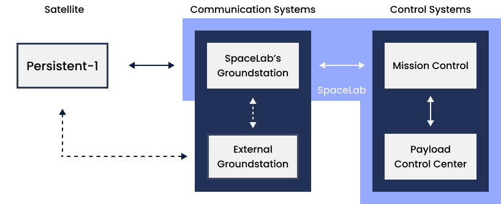
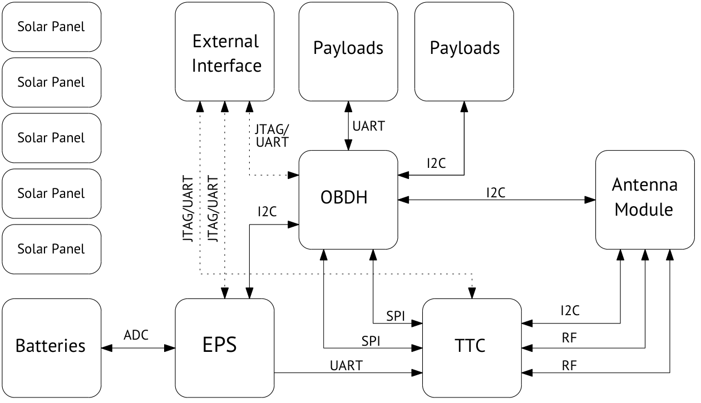
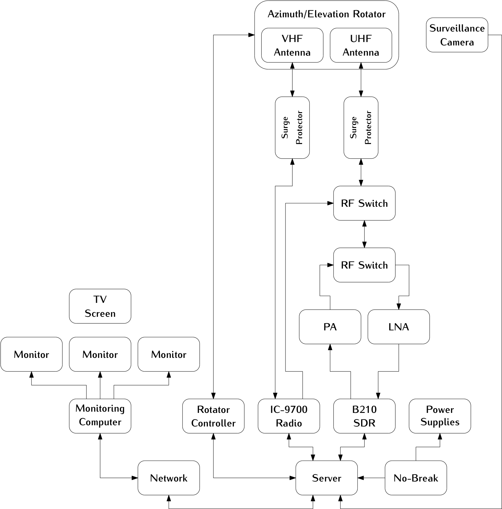
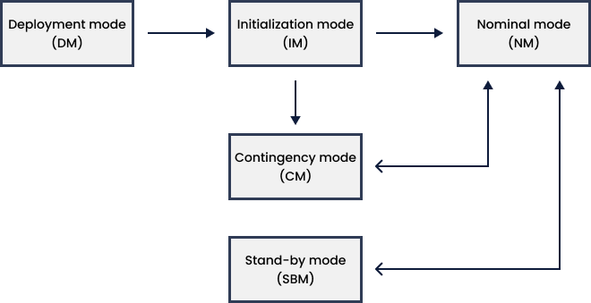

.. conops.rst

    Copyright The Persistent-1 Contributors.

    Persistent-1 Documentation

    This work is licensed under the Creative Commons Attribution-ShareAlike 4.0
    International License. To view a copy of this license,
    visit http://creativecommons.org/licenses/by-sa/4.0/.

.. _ch:conops:

*********************
Concept of Operations
*********************

Introduction
============

This section is dedicated to explaining the satellite's operational concept, outlining its structure and operational modes for the Persistent-1 mission. The mission aims to validate the RE²PS, a power module integrated as a payload on the satellite, and to verify the functionality of a camera added to the satellite. For this purpose, a Low Earth Orbit (LEO) will be utilized at the highest feasible altitude to expose the payloads to the maximum level of radiation possible. These payloads will operate throughout the entire orbit.

Mission description
-------------------

Persistent-1 is a 3U CubeSat designed to validate an advanced electrical power system, the RE²PS, under representative mission conditions and to perform environmental data collection. The RE²PS is the main technological payload, developed by SpaceLab to increase the reliability of power systems for CubeSats without compromising their energy efficiency.

The spacecraft is divided into a 1U sector and a 2U sector. The 1U sector contains the service module, based on the FloripaSat-2 platform, and the Environmental Data Collection (EDC) payload developed by INPE. The EDC is capable of receiving and decoding signals transmitted by Platform Transmitter Terminals belonging to the Brazilian Environmental Data Collection System (SBCD).

The 2U sector is dedicated to the RE²PS payload and the equipment required for its operation and monitoring. The service module provides the infrastructure necessary to operate both payloads and to transmit the collected environmental data, experimental data, and satellite telemetry to the Ground Segment.

Mission structure
=================

.. _fig:conops-arq:

   Persistent-1 mission architecture.

The mission architecture, as depicted in :numref:`fig:conops-arq`, was designed to accommodate the entire mission, considering the communication system between the satellite and Earth, as well as mission control and the data received from the satellite. Thus, the mission will consist of a ground segment composed of SpaceLab’s GroundStation, a space segment with the satellite, and a control module also housed in SpaceLab’s laboratory.

The Persistent-1 communicates with SpaceLab’s GroundStation using VHF and UHF antennas. Other modules will either be attached to SpaceLab’s GroundStation or housed within the laboratory at the Federal University of Santa Catarina.

Space Segment
-------------

.. _fig:conops-space-diagram:

   Persistent-1 Space Segment communications diagram.

The space segment is the primary component of the mission, consisting of the CubeSat to be placed in orbit. The system comprises a 3U CubeSat, consisting of the 1U (service) and 2U (payloads) modules. The 1U module includes OBDH, TTC, and EPS, based on the FloripaSat-2 platform models, providing the necessary infrastructure to accommodate payload modules. The satellite carries as payload a new platform for testing and validation, comprising an adapted OBDH with a daughterboard, TMTC and RE²PS, with the latter being the main focus of the mission's study. Additionally, the mission includes a camera module integrated into the 1U module.

1U Modules
~~~~~~~~~~

The 1U (service) is the core part of the satellite, housing the Electrical Power System (EPS) responsible for generating and distributing power to the satellite modules, an On-Board Data Handling (OBDH) computer responsible for processing and controlling information, and a Telecommand and Telemetry (TTC) module responsible for communication with the ground segment, transmitting and receiving data.

2U Modules
~~~~~~~~~~

The 2U (payloads) pertains to the mission's objective, which is to validate the RE²PS board by exposing it to radiation and verifying its operation. Additionally, the camera module aims to validate data transfer and image acquisition on Earth.

Ground Segment and Mission Control
----------------------------------

.. _fig:conops-grs-diagram:

   Persistent-1 GroundStation diagram.

The mission's Ground Segment will consist of SpaceLab’s Ground Station located at the Federal University of Santa Catarina in Florianópolis, Brazil. The station, still under development, is described in :numref:`fig:conops-grs-diagram` and features two antennas for satellite data transmission and reception, communicating with the satellite's TTC in orbit, which operates in Very High Frequency (VHF) and Ultra High Frequency (UHF).

Data Collection
~~~~~~~~~~~~~~~

With automatic tracking using rotators, the data transmission system includes antennas operating at different frequencies—one in VHF and another in UHF—to receive both payload data and satellite telemetry. A secondary ground station is also under consideration and will be defined.

Control and Coordination
~~~~~~~~~~~~~~~~~~~~~~~~

Control and coordination of the ground segment will be managed by the mission control team, responsible for ensuring the ground segment operates correctly and resolving any issues. The team will also determine when the satellite can receive and send commands and information based on the CubeSat's orbital position. The ground segment is a critical component for mission operation, responsible for receiving, processing, and analyzing data sent by the satellite to monitor mission progress and satellite health.

Mission operation modes
=======================

.. _fig:conops-op-modes:

   Persistent-1 mission operation modes.

The operation modes will be described in the subsections below:

Deployment mode (DM)
--------------------

During satellite launch, it will be in deployment mode, where all functions are deactivated to ensure satellite safety due to non-ideal operating conditions. Once the satellite is stabilized, it will be powered on and transition to the next mode, Initialization Mode (IM).

Initialization mode (IM)
------------------------

In initialization mode, system initialization will begin starting with the OBDH subsystem, which initializes the remaining subsystems to achieve full satellite operation. Antennas remain closed throughout this process. After initialization, the satellite aims to transmit periodic beacons to the GroundStation and determine its initial orientation. Upon establishing a transmission link with Earth, the satellite can operate in its nominal mode (NM), contingency mode (CM), or stand-by mode (SBM).

Nominal mode (NM)
-----------------

In nominal mode of operation, the satellite operates with all functions active. Both the 1U and 2U modules are operational, and antennas are ready to transmit and receive information. The satellite communicates with the ground segment to monitor payload parameters and functionality.

Contingency mode (CM)
---------------------

This mode is activated if a failure in a critical system is identified in the satellite, whether in one of the 1U modules or one of the 2U (payloads).

Stand-by mode (SBM)
-------------------

Stand-by mode is activated when the satellite is in orbits outside the communication footprint with the ground segment, i.e., outside national territory. In this mode, 1U and 2U modules continue operating, and the OBDH monitors voltage levels, current, battery temperature, and other EPS-generated variables relevant to satellite safety. For redundancy, the EPS periodically transmits this information to the TTC.

Mission Control
---------------

The SpaceLab Ground Station, located at the Federal University of Santa Catarina in Florianópolis, Brazil, will be responsible for tracking and controlling Persistent-1. The station will operate in the Very High Frequency (VHF) and Ultra High Frequency (UHF) bands, receiving payload data and satellite telemetry, as well as transmitting telecommands to the spacecraft.

The station will track the satellite using VHF and UHF antennas mounted on a two-axis azimuth and elevation rotator. GPredict will be used for satellite tracking and orbit prediction. A ground station server will allow telecommand transmission and telemetry decoding to be performed remotely. The technical characteristics of the station are presented in :ref:`ch:ground-segment`.
