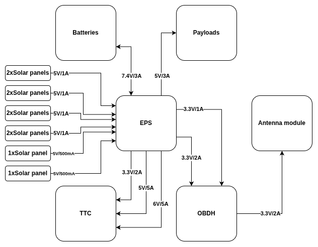
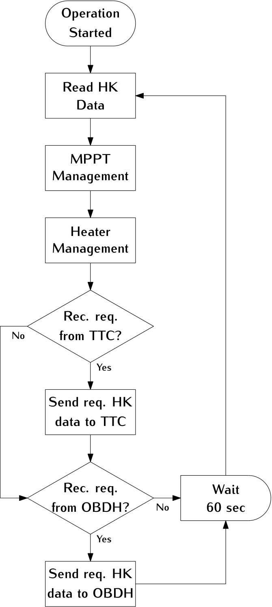
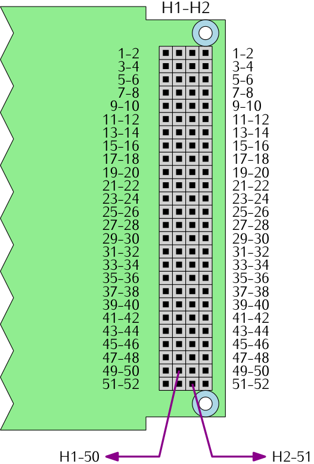
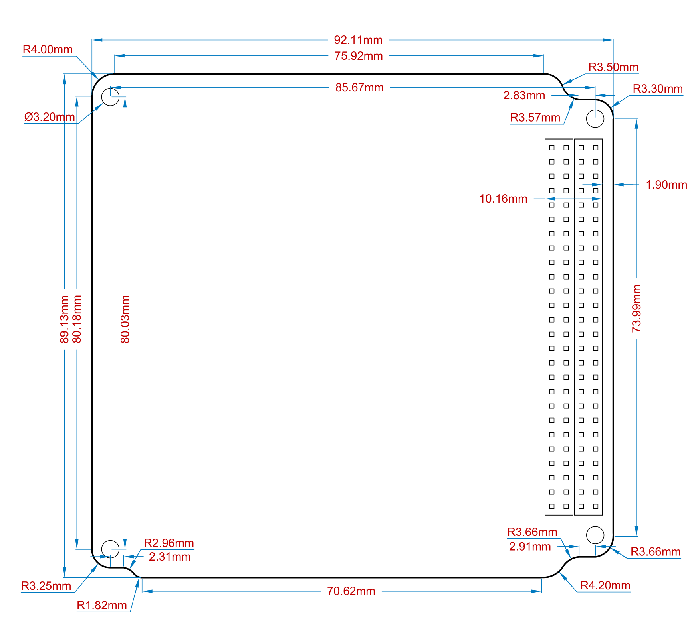
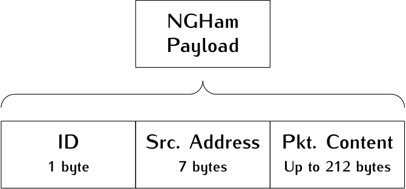
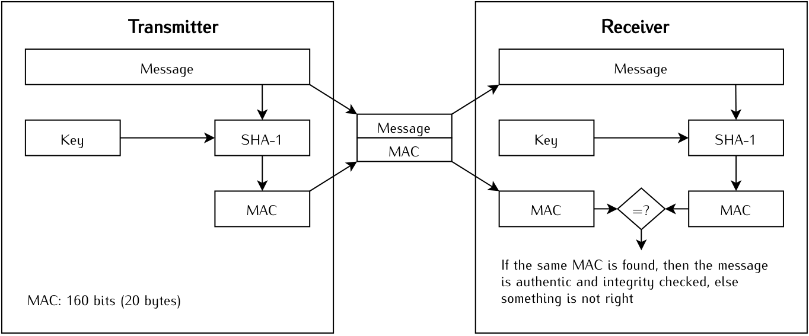

.. design.rst

    Copyright The Persistent-1 Contributors.

    Persistent-1 Documentation

    This work is licensed under the Creative Commons Attribution-ShareAlike 4.0
    International License. To view a copy of this license,
    visit http://creativecommons.org/licenses/by-sa/4.0/.

.. _ch:design:

***********************
Service Module Overview
***********************

This chapter presents the service module that will be used in Catarina-A1. The aim is to show the positioning of the boards in the 2U CubeSat, as well as the communication and power interfaces related to the satellite's service module.

General Diagrams
================

The subsystems of the CubeSat are arranged within the 2U-based physical structure.

.. note::

   The subsystems positioning diagram is not available in the CDR sources yet (:red:`TBD`).

Power Diagram 1U Segment
------------------------

The block diagram depicted in :numref:`fig:power-diagram` provides an overview of the satellite's power distribution system. In particular, several EPS' output converters, with the exception of those dedicated to powering the service module subsystems, can be deactivated via EN pins. The OBDH is in charge of this control, activating or deactivating certain subsystems and/or payloads.

It is crucial to emphasize that the bus designated for the antenna module remains active solely during its deployment phase. In addition, the current values presented in the diagram represent the maximum capacity rather than the nominal operating values. Actual operational values depend upon the variable power output of the solar panels and the varying loads experienced during the satellite's mission.

.. _fig:power-diagram:

   Power diagram.

Power Diagram 2U Segment
------------------------

:red:`TBD`

Data Path Diagram
-----------------

.. note::

   The data path diagram is not available in the CDR sources yet (:red:`TBD`).

Deployment Sequence
-------------------

The deployment sequence of the satellite is the routine to be executed just after the launch. The main objective of this operation is to deploy the antennas and prepare the satellite to start its normal operation.

After the satellite is ejected from the deployer, the kill switches enable the electric power and the three core modules to execute the boot sequence (EPS, OBDH and TTC). The EPS module is ready to operate when the boot finishes. The OBDH and the TTC modules waits for a determined period before starting the normal execution.

As the OBDH and the TTC have access to the antenna module, both subsystems can control the deployment of the antennas. Following the CDS specifications :cite:`cds`, all CubeSats must wait 30 minutes to deploy the antennas and 45 minutes to transmit any RF signal. This way, the OBDH waits 45 minutes to send the deployment command to the antenna module. As redundancy, the TTC waits 55 minutes to execute the same operation.

:numref:`fig:deployment-flowchart` has a flowchart that illustrates the deployment sequence of the service modules.

.. _fig:deployment-flowchart:

   Flowchart of the deployment sequence.

Beacon Operation
----------------

After the beacon microcontroller's boot sequence, the beacon's operation starts. The normal operation consists of reading the data from the EPS and the TTC modules, transmitting the valid data (EPS or TTC package, in this order of priority), waiting 60 seconds, and repeating this sequence. :numref:`fig:beacon-flowchart` has a flowchart of this behavior.

.. _fig:beacon-flowchart:

   Flowchart of the normal beacon operation.

OBDH Operation
--------------

After the boot sequence of the OBDH microcontroller, the operation of the OBDH starts. The regular operation consists of reading the housekeeping data from the EPS, TTC, payloads, antenna module, and the OBDH (its own housekeeping data), saving the read data on the non-volatile memory, and transmitting the housekeeping data of the satellite as a beacon. After that, it waits 60 seconds and checks if a new telecommand was received; if true, it processes the telecommand; if not, it does nothing. After this sequence, these steps start again. :numref:`fig:obdh-flowchart` has a flowchart of this behavior.

.. _fig:obdh-flowchart:

   Flowchart of the normal OBDH operation.

Telecommand Processing
~~~~~~~~~~~~~~~~~~~~~~

:numref:`fig:tc-flowchart` shows the telecommand processing flow.

.. _fig:tc-flowchart:

   Flowchart of telecommand processing.

EPS Operation
-------------

The operation of the EPS microcontroller starts shortly after the release of the CubeSat in its orbit by the deployer. In the first 60 minutes, the module operation consists of reading the housekeeping data from its sensors and managing the duty cycles of the MPPT and heaters. When operational, the TTC and OBDH modules send separate periodic requests to the EPS for forwarding, the housekeeping data acquired. The TTC receives a simplified version, while the OBDH receives a complete version of the data. :numref:`fig:eps-flowchart` has a flowchart of this behavior.

.. _fig:eps-flowchart:

   Flowchart of the normal EPS operation.

RE²PS Operation
---------------

:red:`TBD`

Interface Data Sheet (IDS)
==========================

Interface
---------

To electrically connect all the satellite modules, a PC-104 bus standard is being used. This bus is composed by 104 lines disposed by four rows of 26 pins each (with a vertical and horizontal pitch of 2,54 mm).

Using :numref:`fig:pc104-ref-diagram` as reference, all used positions and signals of the PC-104 bus are presented in :numref:`tab:pc104-pinout`. :numref:`tab:pc104-signals` describes each signal and which modules are connected to them.

.. _fig:pc104-ref-diagram:

   Reference diagram of the PC-104 bus (top view of a generic module).

.. _tab:pc104-pinout:

.. list-table:: PC-104 bus pinout.
   :header-rows: 1

   * - **Pin Row**
     - **H1 Odd**
     - **H1 Even**
     - **H2 Odd**
     - **H2 Even**
   * - 1-2
     - -
     - -
     - -
     - -
   * - 3-4
     - -
     - -
     - EDC_EN
     - EPL_EN
   * - 5-6
     - -
     - -
     - BE_UART_RX
     - -
   * - 7-8
     - RA_GPIO_0
     - RA_GPIO_1
     - BE_UART_TX
     - GPIO_0
   * - 9-10
     - RA_GPIO_2
     - BE_EN
     - -
     - -
   * - 11-12
     - RA_RESET
     - RA_EN
     - BE_SPI_MOSI
     - BE_SPI_CLK
   * - 13-14
     - -
     - -
     - BE_SPI_CS
     - BE_SPI_MISO
   * - 15-16
     - -
     - -
     - -
     - -
   * - 17-18
     - EPL_UART_RX/TX
     - GPIO_6
     - -
     - GPIO_1
   * - 19-20
     - EPL_UART_TX/RX
     - GPIO_2
     - -
     - GPIO_3
   * - 21-22
     - -
     - -
     - -
     - GPIO_4
   * - 23-24
     - -
     - -
     - -
     - -
   * - 25-26
     - -
     - -
     - PL_VCC
     - PL_VCC
   * - 27-28
     - -
     - -
     - TTC_VCC
     - TTC_VCC
   * - 29-30
     - GND
     - GND
     - GND
     - GND
   * - 31-32
     - GND
     - GND
     - GND
     - GND
   * - 33-34
     - -
     - -
     - -
     - -
   * - 35-36
     - RA_SPI_CLK
     - -
     - ANT_VCC
     - ANT_VCC
   * - 37-38
     - RA_SPI_MISO
     - -
     - -
     - -
   * - 39-40
     - RA_SPI_MOSI
     - RA_SPI_CS
     - -
     - -
   * - 41-42
     - EDC_I2C_SDA
     - -
     - -
     - GPIO_5
   * - 43-44
     - EDC_I2C_SCL
     - -
     - -
     - -
   * - 45-46
     - OBDH_VCC
     - OBDH_VCC
     - BAT_VCC
     - BAT_VCC
   * - 47-48
     - PL_VCC
     - PL_VCC
     - -
     - -
   * - 49-50
     - RA_VCC
     - RA_VCC
     - EPS_I2C_SDA
     - -
   * - 51-52
     - BE_VCC
     - BE_VCC
     - EPS_I2C_SCL
     - -

.. _tab:pc104-signals:

.. list-table:: PC-104 bus signal description.
   :header-rows: 1

   * - **Signal**
     - **Pin(s)**
     - **Used By**
     - **Description**
   * - GND
     - H1-29/30/31/32, H2-29/30/31/32
     - All
     - Ground reference
   * - BAT_VCC
     - H2-45, H2-46
     - EPS
     - Battery terminals (+)
   * - ANT_VCC
     - H2-35, H2-36
     - EPS, ANT
     - Antennas power supply (3.3 V)
   * - OBDH_VCC
     - H1-45, H1-46
     - EPS, OBDH
     - OBDH power supply (3.3 V)
   * - TTC_VCC
     - H2-27, H2-28
     - EPS, TTC
     - TTC power supply (3.3 V)
   * - PL_VCC
     - H1-47/48, H2-25/26
     - EPS, EDC, ExpLoRa
     - Payloads power supply (5 V)
   * - RA_VCC
     - H1-49, H1-50
     - EPS, TTC
     - Main radio power supply (5 V)
   * - BE_VCC
     - H1-51, H1-52
     - EPS, TTC
     - Beacon power supply (6 V)
   * - RA_SPI_CLK
     - H1-35
     - OBDH, TTC
     - CLK signal of the main radio SPI bus
   * - RA_SPI_MISO
     - H1-37
     - OBDH, TTC
     - MISO signal of the main radio SPI bus
   * - RA_SPI_MOSI
     - H1-39
     - OBDH, TTC
     - MOS signal of the main radio SPI bus
   * - RA_SPI_CS
     - H1-40
     - OBDH, TTC
     - CS signal of the main radio SPI bus
   * - EPS_I2C_SDA
     - H2-49
     - OBDH, EPS
     - SDA signal of the EPS I2C bus
   * - EPS_I2C_SCL
     - H2-51
     - OBDH, EPS
     - SCL signal of the EPS I2C bus
   * - BE_UART_RX
     - H2-5
     - EPS, TTC
     - EPS TX, Beacon RX (UART bus)
   * - BE_UART_TX
     - H2-7
     - EPS, TTC
     - EPS RX, Beacon TX (UART bus)
   * - EPL_UART_TX/RX
     - H1-25
     - OBDH, ExpLoRa
     - OBDH TX, ExpLoRa RX (UART bus)
   * - EPL_UART_RX/TX
     - H1-27
     - OBDH, ExpLoRa
     - OBDH RX, ExpLoRa TX (UART bus)
   * - BE_EN
     - H1-10
     - EPS, TTC
     - Beacon radio power enable
   * - RA_EN
     - H1-12
     - EPS, OBDH
     - Main radio power enable
   * - EDC_EN
     - H2-3
     - OBDH, EDC
     - EDC enable signal
   * - EPL_EN
     - H2-4
     - OBDH, ExpLoRa
     - ExpLoRa enable signal
   * - EDC_I2C_SDA
     - H1-41
     - OBDH, EDC
     - SDA signal of the payload I2C bus
   * - EDC_I2C_SCL
     - H1-43
     - OBDH, EDC
     - SCL signal of the payload I2C bus
   * - GPIO_N
     - H1-20, H2-8/18/20/22/42
     - OBDH
     - GPIO pin (not used)

This project's distribution pattern of pins is a mix of multiple patterns from CubeSat module manufacturers, like GomSpace, ISIS, and Endurosat. Some pins are positioned to meet specific project requirements, and the adopted pattern may only be partially compatible with some commercial modules.

Beyond the PC-104 bus, some signals are connected directly by wires and cables, like the control and power pins of the antenna module, the battery charger, and the programming ports.

Form Factor
-----------

The form factor follows a similar specification of the PC-104 standard :cite:`pc104-specification`. The connector used for the interface differs given the module; the isolation height and presence of a pin or receptacle are defined from the overall stack up of the subsystems inside the CubeSat 2U structure. The core modules have smoothed edges, and some linear mounting hole distances are different from the standard; these are according to fit in a CubeSat form factor. The PC-104 form factor used can be seen in :numref:`fig:pc104-form-factor`.

.. _fig:pc104-form-factor:

   PC-104 form factor.

Telecommunication
=================

This section describes the configuration and behavior of the telecommunication subsystems of the satellite. There are three types of links available in the CubeSat: beacon, downlink, and uplink. The beacon link is a periodic transmission of packets with basic telemetry data of the satellite (containing data from the EPS or TTC subsystems). The downlink is the link used to receive all data from the satellite, including the results of all experiments, telemetry data, and telecommands feedback. Moreover, the uplink sends telecommands from a ground station to the satellite.

The payload of all packets follows the same structure, with an *ID* number, the source address (callsign), and the packet's content (variable according to each type of packet). Following the NGHam protocol characteristics, the maximum packet length, including the *ID* and the source address, is 220 bytes. :numref:`fig:fsat-pkt-structure` illustrates this packet structure.

.. _fig:fsat-pkt-structure:

   Payload structure of the Catarina-A1 packets.

:numref:`tab:packets-struct` summarizes all types of packets transmitted or received by satellite, with the *ID* number, structure and length, and access type of each packet.

.. _tab:packets-struct:

.. list-table:: Telecommunication packets and their content.
   :header-rows: 1

   * - **Link**
     - **Packet Name**
     - **Payload ID**
     - **Payload Source Callsign**
     - **Payload Data (up to 220 bytes)**
     - **Size (bytes)**
     - **Access**
   * - Beacon
     - EPS data
     - 00h
     - “ ” + “PY0EFS”
     - EPS data
     - 46
     - Public
   * - 
     - TTC Data
     - 01h
     - 
     - TTC data
     - 19
     - Public
   * - Downlink
     - General telemetry
     - 20h
     - “ ” + “PY0EFS”
     - OBDH/EPS data
     - 78
     - Public
   * - 
     - Ping answer
     - 21h
     - 
     - Requester callsign
     - 15
     - Public
   * - 
     - Data request answer
     - 22h
     - 
     - Requester callsign + data *ID* + ts. + data
     - 20 to 220
     - Public
   * - 
     - Message broadcast
     - 23h
     - 
     - Requester + dst. callsign + message
     - 22 to 60
     - Public
   * - 
     - Payload data
     - 24h
     - 
     - Payload *ID* + payload data
     - 9 to 220
     - Public
   * - 
     - TC feedback
     - 25h
     - 
     - Req. callsign + TC packet *ID* + timestamp
     - 20
     - Public
   * - 
     - Parameter value
     - 26h
     - 
     - Req. callsign + Sub. *ID* + Param. *ID* + Param. Val.
     - 21
     - Public
   * - Uplink
     - Ping request
     - 40h
     - Any Callsign
     - None
     - 8
     - Public
   * - 
     - Data request
     - 41h
     - 
     - Data *ID* + Start ts. + End ts. + Hash
     - 37
     - Private
   * - 
     - Broadcast Message
     - 42h
     - 
     - Dst. callsign + message
     - 15 to 53
     - Public
   * - 
     - Enter hibernation
     - 43h
     - 
     - Hibernation in hours + Hash
     - 30
     - Private
   * - 
     - Leave hibernation
     - 44h
     - 
     - Hash
     - 28
     - Private
   * - 
     - Activate module
     - 45h
     - 
     - Module *ID* + Hash
     - 29
     - Private
   * - 
     - Deactivate module
     - 46h
     - 
     - Module *ID* + Hash
     - 29
     - Private
   * - 
     - Activate payload
     - 47h
     - 
     - Payload *ID* + Hash
     - 29
     - Private
   * - 
     - Deactivate payload
     - 48h
     - 
     - Payload *ID* + Hash
     - 29
     - Private
   * - 
     - Erase memory
     - 49h
     - 
     - Hash
     - 28
     - Private
   * - 
     - Force reset
     - 4Ah
     - 
     - Hash
     - 28
     - Private
   * - 
     - Get payload data
     - 4Bh
     - 
     - Payload *ID* + Args. + Hash
     - 41
     - Private
   * - 
     - Set parameter
     - 4Ch
     - 
     - Subsystem *ID* + Param. *ID* + Param. value + Hash
     - 34
     - Private
   * - 
     - Get parameter
     - 4Dh
     - 
     - Subsystem *ID* + Parameter *ID* + Hash
     - 30
     - Private

The *ID* of the subsystems, modules, and payloads are available in :numref:`tab:system-ids`.

.. _tab:system-ids:

.. list-table:: *ID*\ s of the satellite.
   :header-rows: 1

   * - **Type**
     - ***ID* Number**
     - **Description**
   * - Subsystem
     - 0
     - OBDH
   * - 
     - 1
     - TTC 1
   * - 
     - 2
     - TTC 2
   * - 
     - 3
     - EPS
   * - Module
     - 1
     - Battery heater
   * - 
     - 2
     - Beacon
   * - 
     - 3
     - Periodic telemetry
   * - Payload
     - 1
     - EDC
   * - 
     - 2
     - ExpLoRa

Authentication
--------------

All the telecommands classified as private use an HMAC authentication scheme. Every type of private telecommand has a unique 16-digit ASCII character key that with the telecommand sequence (or message) generates an 160-bits (20-bytes) hash sequence to be transmitted together with the packet payload. The used hash algorithm is the SHA-1. :numref:`fig:hmac-diagram` illustrates this authentication method.

.. _fig:hmac-diagram:

   Diagram of the used HMAC scheme.

Operation Licenses
------------------

Regarding the non-amateur radios frequencies, Resolution 685, of October 9, 2017 from ANATEL establishes that:

Art. 9. Assign to the Private Limited Service (SLP), for use by systems for capturing and transmitting scientific data related to space operation, on a secondary basis, the following sub-ranges (related to this project):

* 400.15 to 401 MHz;

* 401 to 403 MHz.

* 468 to 469 MHz

Art. 17. The allocation of all radio frequency bands dealt with in this Resolution follows the restrictions imposed by the respective allocation.

Single paragraph. Those interested in the use of the radio frequency bands object of this Resolution must provide in their projects, until specific regulations are issued on the conditions of use of these bands, criteria for harmonious coexistence with the existing systems in these bands, maintaining specific coordination, when necessary, of such so that incoming systems do not cause harmful interference to existing systems.
