.. ground_segment.rst

    Copyright The Persistent-1 Contributors.

    Persistent-1 Documentation

    This work is licensed under the Creative Commons Attribution-ShareAlike 4.0
    International License. To view a copy of this license,
    visit http://creativecommons.org/licenses/by-sa/4.0/.

.. _ch:ground-segment:

**************
Ground Segment
**************

This chapter describes the ground segment of the mission. It consists of a ground station on SpaceLab premises.

Control of the mission and reception of the data collected will be carried out at the ground stations, but if necessary any station in the world can use the amateur radio link, provided it has the necessary equipment.

UFSC Ground Station
===================

The UFSC ground station is currently being developed and prepared to be used for several missions developed by UFSC. This section presents the project of this station. A general block diagram can be seen in :numref:`fig:grs-block-diagram`.

.. _fig:grs-block-diagram:

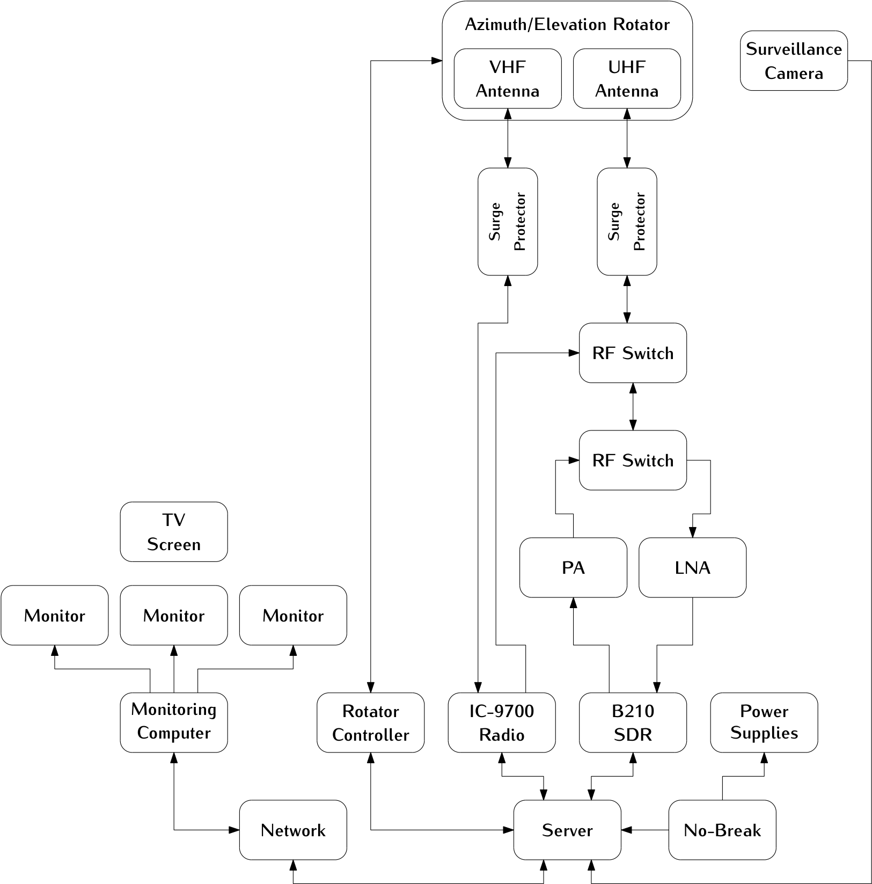

   Block diagram of the Ground Segment (UFSC ground station).

In the following sections, a description of the main components of the station will be presented.

Hardware
--------

This part describes the hardware side of the UFSC ground station and details the main peripherals that will be used in this project. Most of the components described here are represented in :numref:`fig:grs-block-diagram`.

Antennas
~~~~~~~~

There are two antennas in the ground station: One for VHF and one for the UHF band. The main characteristics of these antennas can be seen in :numref:`tab:grs-antennas`

.. _tab:grs-antennas:

.. list-table:: Main characteristics of the Ground Segment antennas.
   :header-rows: 1

   * - **Characteristic**
     - **VHF Antenna**
     - **UHF Antenna**
     - **Unit**
   * - Brand
     - M²
     - Cushcraft
     - -
   * - Model
     - 2MCP14
     - A719B
     - -
   * - Type
     - Yagi
     - Yagi
     - -
   * - Number of elements
     - 14
     - 19
     - -
   * - Frequency range
     - 143-148
     - 430-450
     - MHz
   * - Gain
     - 12.34
     - 15.5
     - dBi
   * - Power rating
     - 1500
     - 2000
     - W
   * - Boom length
     - 3.2
     - 4.1
     - m
   * - Longest element
     - 1.02
     - 0.34
     - m
   * - Weight
     - 2.72
     - 2.55
     - kg

More information about the VHF and UHF antennas can be found in :cite:`2mcp14` and :cite:`a719b` respectively.

Surge Protector
^^^^^^^^^^^^^^^

Two surge protectors will be used to protect the ground station electronics of possible atmospheric discharges in the outside components (one for each antenna). The gas surge protectors safely discharge/deflect up to 5000 A of peak current to earth without causing damage to an independent ground. This device is installed near the antennas, in cascade with the RF cables.

For this project, the model MFJ-270N will be used, and a picture of it can be seen in :numref:`fig:mfj-270n`.

.. _fig:mfj-270n:

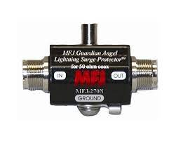

   MFJ-270N surge protector.

Rotators
~~~~~~~~

Both antennas (VHF and UHF) track the satellite through a two axis rotator (azimuth and elevation). The used model is the Yaesu G-5500, which provides 450° azimuth and 180° elevation control of medium and large size unidirectional satellite antenna arrays under remote control from station operation position.

A picture of the G-5500 rotator (and controller) can be seen in :numref:`fig:g5500`; the main characteristics can be found in :numref:`tab:grs-rotor`.

.. _fig:g5500:

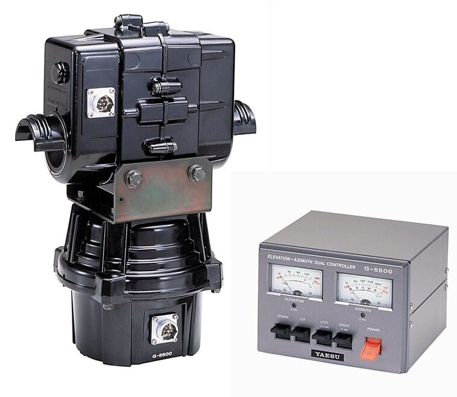

   Yaesu G-5500 rotator and controller.

.. _tab:grs-rotor:

.. list-table:: Main characteristics of antennas' rotators.
   :header-rows: 1

   * - **Characteristic**
     - **Value**
     - **Unit**
   * - Brand
     - Yaesu
     - -
   * - Model
     - G-5500
     - -
   * - Voltage requirement
     - 110-120 or 200-240
     - :math:`V_{AC}`
   * - Motor voltage
     - 24
     - V\ :math:`_{AC}`
   * - Rotation time (elevation, 180°)
     - 67
     - s
   * - Rotation time (azimuth, 360°)
     - 58
     - s
   * - Maximum continuous operation
     - 5
     - min
   * - Rotation torque (elevation)
     - 14
     - kg-m
   * - Rotation torque (azimuth)
     - 6
     - kg-m
   * - Braking torque (elevation and azimuth)
     - 40
     - kg-m
   * - Vertical load
     - 200
     - kg
   * - Pointing accuracy
     - ± 4
     - %
   * - Wind surface area
     - 1
     - :math:`m^{2}`
   * - Weight (rotator)
     - 9
     - kg
   * - Weight (controller)
     - 3
     - kg

More information about the ground station rotator can be found in :cite:`g5500`.

Amplifiers
~~~~~~~~~~

There are two dedicated amplifiers in the UFSC ground station: one power amplifier (PA) for transmitting telecommands with a high power signal, and a low noise amplifier (LNA), for amplify the received signals from the satellite. Both are presented next.

Power Amplifier
^^^^^^^^^^^^^^^

The power amplifier is used to add a gain to the generated signals of the transmitter. The used model is the Mini-Circuits ZHL-50W-52-S+ :cite:`zhl50w`. A picture of this power amplifier can be seen in :numref:`fig:zhl-50w`, the main characteristics are available in :numref:`tab:zhl-50w-specs`.

.. _fig:zhl-50w:

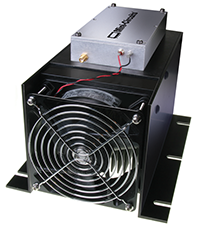

   Mini-Circuits ZHL-50W-52-S+ power amplifier.

.. _tab:zhl-50w-specs:

.. list-table:: Main characteristics of the ZHL-50W-52-S+ power amplifier.
   :header-rows: 1

   * - **Characteristic**
     - **Value**
     - **Unit**
   * - Brand
     - Mini-Circuits
     - -
   * - Model
     - ZHL-50W-52-S+
     - -
   * - Frequency range
     - 50-500
     - MHz
   * - Gain
     - 47-52
     - dB
   * - Noise figure
     - 4.5-7.0
     - dB
   * - DC supply voltage
     - 24-25
     - V
   * - Max. supply current
     - 9.3
     - A

Low Noise Amplifiers
^^^^^^^^^^^^^^^^^^^^

As LNA, the model ZFL-500LN+ from Mini-Circuits :cite:`zfl500ln` is being used. This amplifier will be used just after the antennas to add a gain to the incoming telemetry signals transmitted by the satellite. A picture of the low noise amplifier can be seen in :numref:`fig:lna`, the main characteristics are available in :numref:`tab:lna-specs`.

.. _fig:lna:

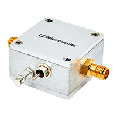

   Mini-Circuits ZFL-500LN+ low noise amplifier.

.. _tab:lna-specs:

.. list-table:: Main characteristics of the ZFL-500LN+ low noise amplifier.
   :header-rows: 1

   * - **Characteristic**
     - **Value**
     - **Unit**
   * - Brand
     - Mini-Circuits
     - -
   * - Model
     - ZFL-500LN+
     - -
   * - Frequency range
     - 0.1-500
     - MHz
   * - Gain
     - 24-28
     - dB
   * - DC supply voltage
     - 15
     - V
   * - Max. supply current
     - 60
     - mA

Radios
~~~~~~

Besides the SDR solution presented in the block diagram of :numref:`fig:grs-block-diagram`, there is also a amateur radio transceiver with a standalone solution for the amateur radio link with the satellite. The used model is the Icom IC-9700 :cite:`ic9700`, that is an RF direct sampling receiver for 2 m and 70 cm. The IF receiver consists of a single down conversion for 23 cm that is between 311 and 371 MHz. The PA provides 100 W on 2 m, 75 W on 70 cm, and 10 W on 23 cm.

In addition to band-specific memory channels, the IC-9700 allows the band-specific receiver and transmitter settings. For transmission, users can adjust RF power, TX power Limit, Limit Power, and TX Delay by the band. Basic receiver settings, like the Noise Blanker, Noise Reduction, and others, can be tweaked by the band with a dynamic Notch and Filter setup by band/mode. A picture of the IC-9700 radio can be seen in :numref:`fig:ic9700`.

.. _fig:ic9700:

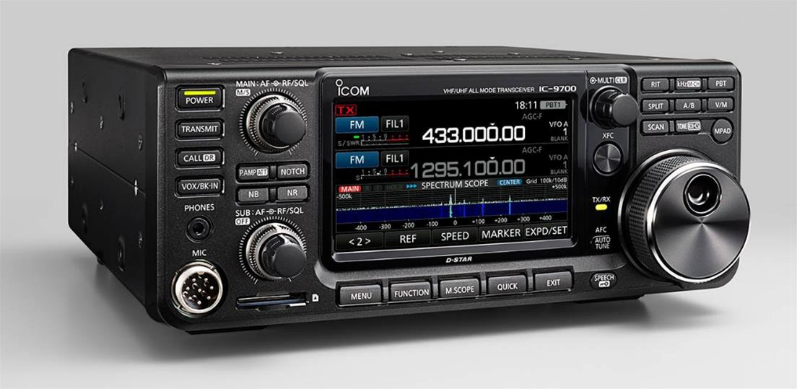

   Icom IC-9700 radio transceiver.

Software Defined Radio
^^^^^^^^^^^^^^^^^^^^^^

As presented in :numref:`fig:grs-block-diagram`, the Ground Segment also has an SDR as a transceiver. The used model is the USRP B210, from Ettus Research :cite:`b210`, a fully integrated, single-board SDR with continuous frequency coverage from 70 MHz to 6 GHz. It combines the AD9361 RFIC direct-conversion transceiver providing up to 56 MHz of real-time bandwidth, an open and reprogrammable Spartan6 FPGA, and USB 3.0 connectivity. Also, full support for the USRP Hardware Driver (UHD) software allows the use of the GNURadio framework. A picture of the USRP B210 SDR (with enclosure) can be seen in :numref:`fig:usrp-b210`.

.. _fig:usrp-b210:

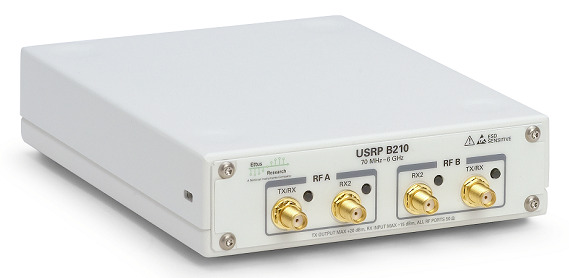

   Ettus USRP B210 SDR.

Processing and Control
~~~~~~~~~~~~~~~~~~~~~~

The ground station control room shall have two monitors and a dedicated computer alongside most of the previously presented hardware. It will work as a monitoring room with a nobreak to protect the equipment from power grid fluctuations.

The antennas and rotator will also be monitored with outside cameras. And the room will count with a server so that the transmission and decoding can be done remotely and at any time.

:numref:`fig:server` shows a picture of the used server, and :numref:`tab:server` presents its main characteristics.

.. _tab:server:

.. list-table:: Main characteristics of the Dell PowerEdge R240 server.
   :header-rows: 1

   * - **Characteristic**
     - **Value**
   * - Brand
     - Dell
   * - Model
     - PowerEdge R240
   * - Processor
     - Intel Xeon E-2244G 3.8 GHz 4C/8T
   * - RAM Memory
     - 16 GB DDR4 ECC
   * - Storage
     - 1 TB HD

.. _fig:server:

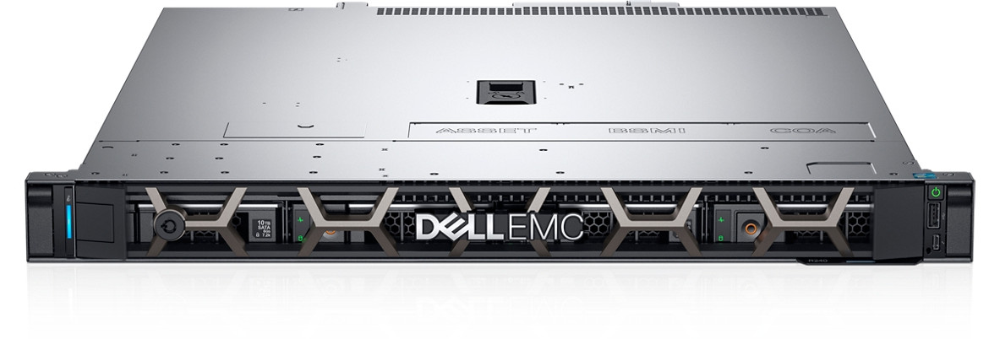

   Dell PowerEdge R240 server.

Satellite Tracking
------------------

To track the satellite and for orbit prediction, the GPredict software :cite:`gpredict` will be used. Gpredict is a real-time satellite tracking and orbit prediction application. It can track many satellites and display their position and other data in lists, tables, maps, and polar plots (radar view). Gpredict can also predict the time of future passes for a satellite and provide detailed information about each pass. Gpredict is free software licensed under the GNU General Public License. A picture of the main window of GPredict can be seen in :numref:`fig:gpredict`.

.. _fig:gpredict:

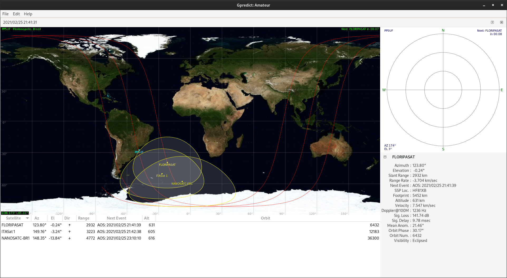

   Main window of GPredict.

Packet Transmission
-------------------

The packet generation and transmission to Persistent-1 satellite can be done with the SpaceLab-Transmitter software :cite:`spacelab-transmitter`, which was written in Python with the interface developed using the GTK framework. It has a USRP Handler made with Ettus libraries to work with Ettus USRP B210 as shown in :numref:`fig:usrp-b210`. The supported modulation is the Gaussian Minimum Shift Keying (GMSK). Furthermore, the software also has unit tests for the main modules and a logging system to record events such as an initialization or a successfully transmitted telecommand.

:numref:`fig:transmitter-tree` shows the product tree of the software, which contains its main elements, and :numref:`fig:spacelab-transmitter` shows its main window.

.. _fig:transmitter-tree:

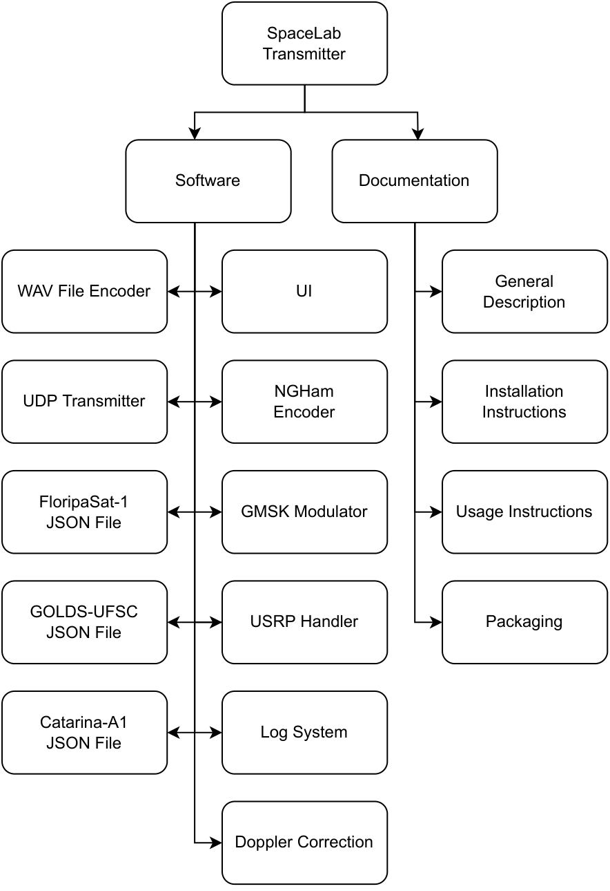

   SpaceLab-Transmitter product tree.

.. _fig:spacelab-transmitter:

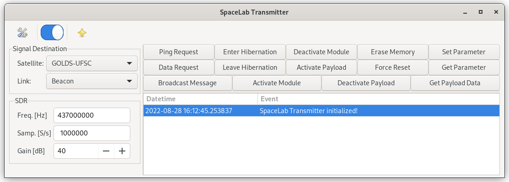

   Main window of the SpaceLab-Transmitter application.

Packet Decoding
---------------

The packet decoding of Persistent-1 satellite telemetry can be done using the SpaceLab-Decoder :cite:`spacelab-decoder` software using a .wav file or through a real time reception. The decoded telemetry will appear in a dialog within the main window. The software was written in Python, and the interface was developed using GTK framework. Furthermore, the software also has unit tests for the main modules and a logging system to record events.

:numref:`fig:decoder-tree` shows the product tree of the software, which contains its main elements, and :numref:`fig:spacelab-decoder` shows its main window.

.. _fig:decoder-tree:

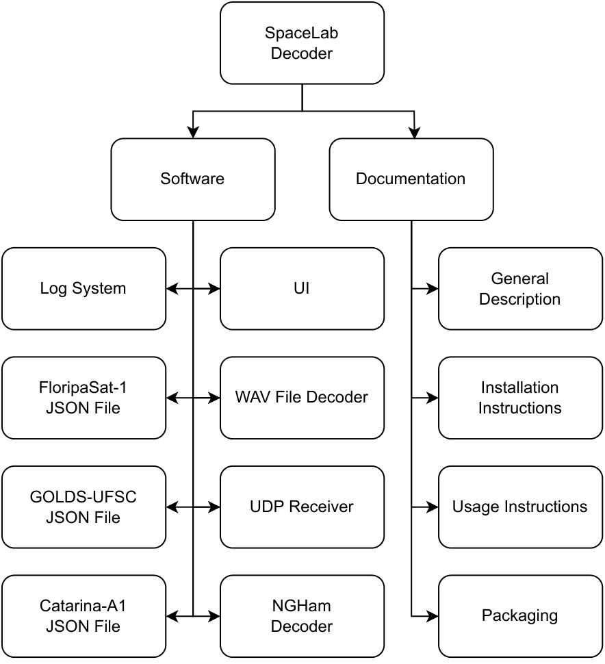

   SpaceLab-Decoder product tree.

.. _fig:spacelab-decoder:

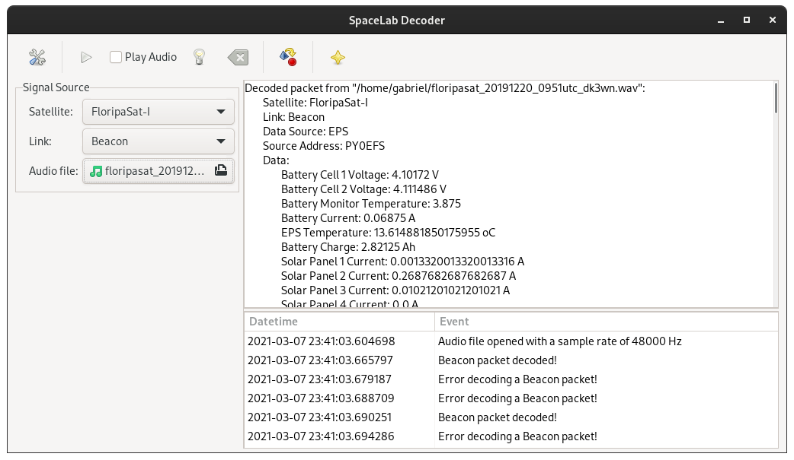

   Main window of the SpaceLab-Decoder application.
