.. management.rst

    Copyright The Persistent-1 Contributors.

    Persistent-1 Documentation

    This work is licensed under the Creative Commons Attribution-ShareAlike 4.0
    International License. To view a copy of this license,
    visit http://creativecommons.org/licenses/by-sa/4.0/.

.. _ch:management:

******************
Mission Management
******************

This chapter presents the general management of the mission. The items presented in this section are: Schedule; Cost Estimation; Product Tree for the mission; Work Breakdown Structure (WBS); and Risk management for the mission.

Schedule
========

This section comprises the updated schedule control of the Persistent-1.

Schedule definition
-------------------

:numref:`fig:schedule` illustrates the mission schedule as of this date. The programme has been continuously updated since it was first presented in the mission design review (MDR).

.. _fig:schedule:

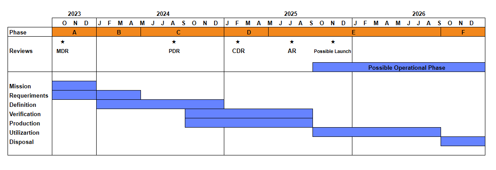

   Persistent-1 space system’s schedule

Schedule control
----------------

:red:`TBD`

Procurement status
------------------

:numref:`tab:procurement-status` indicates the current status of the purchase of major items necessary to carry out the mission for the Persistent-1. The EPS and SLCAN are already available at Florianópolis - SC. Other items listed are planned to initiate the procurement process in Sep 2024.

.. _tab:procurement-status:

.. list-table:: Procurement Status.
   :header-rows: 1

   * - **Item**
     - **Status**
   * - Solar panel
     - Initiated
   * - Antenna
     - Not initiated
   * - Structure
     - Not initiated
   * - EPS module
     - Ready
   * - ACS components
     - Not initiated
   * - OBDH module
     - Not initiated
   * - TMTC module
     - Not initiated
   * - SLCAN
     - Ready

Cost Estimation
===============

The cost concept described here will present the amounts to be spent on each module of the Persistent-1 satellite, as well as presenting the project budget and current situation.

Cost Breakdown Structure
------------------------

:numref:`tab:consumables-budget` shows the estimated budget for the acquisition of each satellite module. This calculation was drawn up for the submission of the proposal to CNPq. As discussed in the previous section, not all the modules have been purchased to date; however, the project intends to continue with this budget planning.

.. _tab:consumables-budget:

.. list-table:: Consumables budget (estimated cost per satellite module).
   :header-rows: 1

   * - **Item description**
     - **Quantity**
     - **Value (R$)**
   * - Structure
     - 1
     - 30000.00
   * - Solar panels
     - 1
     - 250000.00
   * - Interface boards
     - 1
     - 3000.00
   * - Antenna module
     - 1
     - 77000.00
   * - OBDH EM
     - 1
     - 10000.00
   * - TTC EM
     - 1
     - 10000.00
   * - EPS EM
     - 1
     - 10000.00
   * - Battery module EM
     - 1
     - 2000.00
   * - Payload EM
     - 1
     - 20000.00
   * - OBDH FM
     - 1
     - 20000.00
   * - TTC FM
     - 1
     - 20000.00
   * - EPS FM
     - 1
     - 20000.00
   * - Battery module FM
     - 1
     - 5000.00
   * - Payload FM
     - 1
     - 20000.00
   * - Cables
     - 1
     - 5000.00
   * - Screws, resins, etc
     - 1
     - 5000.00
   * - **Total**
     - 
     - **497000.00**

Project budget
--------------

:numref:`tab:project-budget` shows the amounts allocated to the project based on the proposal submitted to CNPq. So far, the only expenditure made with the project's funds has been the payment of grants. This includes various categories of grants, such as DTI-C, ADC-1B, Technological Initiation in TICs - ITC-A, DTI-B, ADC-2A, DTI-A and ITI A, each detailed in the table.

.. _tab:project-budget:

.. list-table:: Project budget.
   :header-rows: 1

   * - Item
     - Type
     - Unit (R$)
     - Quantity
     - Total (R$)
   * - Import costs
     - Costs
     - 
     - 
     - R$ 0.00
   * - Consumables
     - Costs
     - 
     - 
     - R$ 497 000.00
   * - Third parties (legal entities)
     - Costs
     - 
     - 
     - R$ 20 000.00
   * - Third parties (individuals)
     - Costs
     - 
     - 
     - R$ 0.00
   * - Daily rates
     - Costs
     - 
     - 
     - R$ 16 000.00
   * - Flight tickets
     - Costs
     - 
     - 
     - R$ 12 800.00
   * - Bibliographic material
     - Capital
     - 
     - 
     - R$ 0.00
   * - Equipment and permanent material
     - Capital
     - 
     - 
     - R$ 20 000.00
   * - DTI-C
     - Scholarships
     - R$ 1 100.00
     - 1
     - R$ 35 200.00
   * - ADC-1B
     - Scholarships
     - R$ 3 000.00
     - 1
     - R$ 72 000.00
   * - TICs - ITC-A
     - Scholarships
     - R$ 500.00
     - 1
     - R$ 16 000.00
   * - DTI-B
     - Scholarships
     - R$ 3 000.00
     - 4
     - R$ 96 000.00
   * - ADC-2A
     - Scholarships
     - R$ 483.00
     - 1
     - R$ 11 562.00
   * - DTI-A
     - Scholarships
     - R$ 4 000.00
     - 1
     - R$ 128 000.00
   * - ITI A
     - Scholarships
     - R$ 400.00
     - 2
     - R$ 12 800.00
   * - Total
     - 
     - 
     - 
     - R$ 998 192.00

Product Tree
============

The Persistent-1 satellite product tree is the division of the project into successive levels of hardware and software products (or elements). The project's product tree can be seen in the diagram in :numref:`fig:product-tree`. As shown, the satellite has been divided into two, Space and Ground segments.

.. _fig:product-tree:

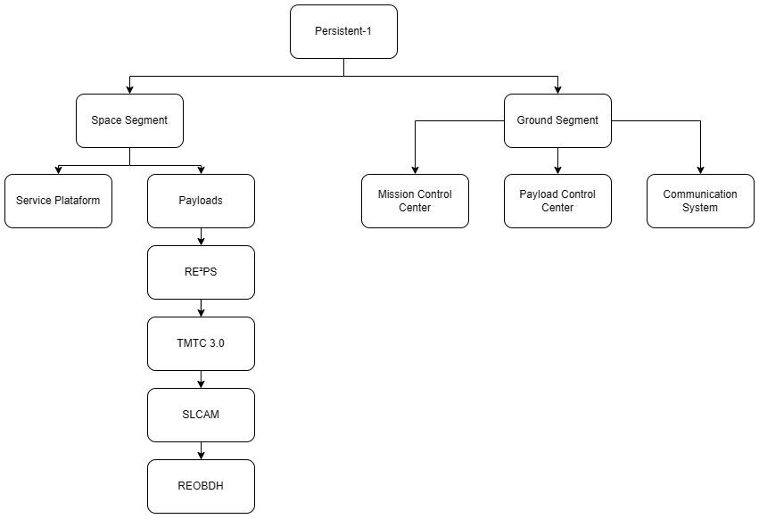

   Product tree of Persistent-1.

The supplier of each satellite item is presented in :numref:`tab:suppliers`.

.. _tab:suppliers:

.. list-table:: Suppliers.
   :header-rows: 1

   * - **Element**
     - **Supplier**
   * - Satellite
     - UFSC
   * - Mechanical Structure
     - Usiped
   * - EPS Hardware
     - SpaceLab
   * - EPS Firmware
     - SpaceLab
   * - Battery Module
     - SpaceLab
   * - Solar Panels
     - Orbital
   * - TMTC
     - Spacelab
   * - Antenna
     - ISISpace
   * - OBDH
     - Spacelab

Work Breakdown Structure
========================

The Work Breakdown Structure (WBS) is shown as a diagram in :numref:`fig:wbs`. The WBS is divided into work packages (WP), as shown in the diagram.

.. _fig:wbs:

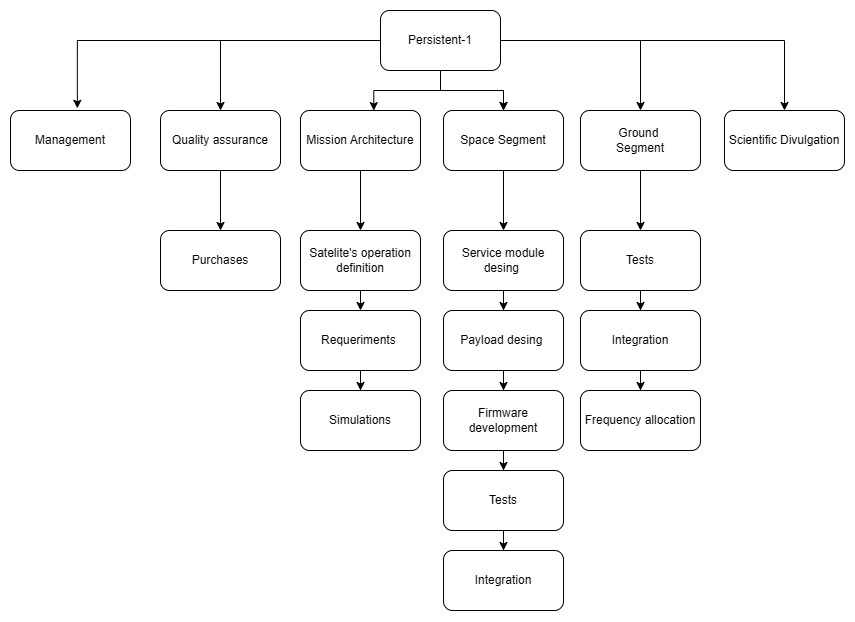

   Work breakdown structure.

.. _sec:risks:

Risk Management
===============

A risk is an event that threatens the project's success, even if partially. Therefore, this plan aims to help identify adverse events at an early stage, handle them, and mitigate them. The development of this project will be based on a qualitative risk analysis standard. This depends on crossing two metrics: the probability of risk occurrence and the impact of risk occurrence.

Risks Classification
--------------------

:numref:`tab:risks-severity`, :numref:`tab:risks-likelihood` and :numref:`tab:risk-level` follow the ECSS-M-ST-80C standards for categorising risks into severity and likelihood.

.. _tab:risks-severity:

.. list-table:: Risk Severity and Impact Assessment
   :header-rows: 1

   * - **Risk Index**
     - **Severity**
     - **Technical Performance Impact**
     - **Schedule Impact**
     - **Cost Impact**
   * - 5
     - Catastrophic
     - *Complete cubesat failure, mission irrecoverable. Inability to achieve scientific goals.*
     - *Launch window missed*
     - *> 8% overrun*
   * - 4
     - Critical
     - *Total component failure, potential recovery with significant delays.*
     - *Launch delay due to schedule slippage*
     - *2% - 8% overrun*
   * - 3
     - Moderate
     - *Partial component failure, recovery possible with moderate impact on mission timeline.*
     - *Internal delays, launch date unaffected*
     - *1% - 2% overrun*
   * - 2
     - Negligible
     - *Minor system issue, no impact on satellite's overall health or operational capabilities.*
     - *Minor internal delays, milestones unaffected*
     - *0.5% - 1% overrun*

.. _tab:risks-likelihood:

.. list-table:: Risk Likelihood of Occurrence
   :header-rows: 1

   * - **Risk Index**
     - **Likelihood**
     - **Likelihood of Occurrence**
   * - E
     - Maximum
     - *Certain to occur, will occur one or more times per project*
   * - D
     - High
     - *Will occur frequently, about 1 in 10 projects*
   * - C
     - Medium
     - *Will occur sometimes, about 1 in 100 projects*
   * - B
     - Low
     - *Will seldom occur, about 1 in 1000 projects*
   * - A
     - Minimum
     - *Will almost never occur, 1 of 10 000 or more projects*

.. _tab:risk-level:

.. list-table:: Risk Level and Management Actions
   :header-rows: 1

   * - **Risk Index**
     - **Risk Magnitude**
     - **Proposed Actions**
     - **Approach**
   * - E4, E5, D5
     - Very High
     - Unacceptable: Implement new team process or change baseline. Seek project management attention at a high management level.
     - M
   * - E3, D4, C5
     - High
     - Unacceptable: See above.
     - M
   * - E2, D3, C4, B5
     - Medium
     - Unacceptable: Aggressively manage, consider alternative team process or baseline. Seek attention at appropriate management level.
     - M
   * - E1, D1, D2, C2, C3, B3, B4, A5
     - Low
     - Acceptable: Control and monitor. Seek responsible work package management attention.
     - M
   * - C1, B1, A1, B2, A2, A3, A4
     - Very Low
     - Acceptable: See above.
     - M

Risks identification
--------------------

The risks identified are presented below, categorised by source (system, communications, flight software, ground software, mission operation, EPS, mechanical, thermal, schedule, cost and external), probability of risk occurrence (A-E) and severity (1-5). The *ID* risk is related to the Persistent-1 risk using the SLB-PRS-RSK-TYP_number-RSK_number model and following :numref:`tab:risks-type` for classifying each risk. The trend and approach codes are listed in :numref:`tab:risks-trend-approach`, and the resulting risk level for each combination of severity and likelihood is shown in :numref:`fig:risk-matrix`.

A total of two risks are indicated as high, all identified as flight software ones. They are related to the commissioning of the satellite and the development in-house of the *EPS* and *OBDH* systems.

.. _tab:risks-type:

.. list-table:: Risks Classification
   :header-rows: 1

   * - **Type**
     - **TYP number**
   * - System
     - 0
   * - Comms
     - 1
   * - Flight Software
     - 2
   * - Ground software
     - 3
   * - Mission Operation
     - 4
   * - EPS
     - 5
   * - Mechanical
     - 6
   * - Thermal
     - 7
   * - Schedule
     - 8
   * - Cost
     - 9
   * - External
     - 10

.. _tab:risks-trend-approach:

.. list-table:: Trend and Approach
   :header-rows: 1

   * - **Trend**
     - **Approach**
   * - I - Improving
     - M - Mitigate
   * - A - Accept
     - U - Unchanged
   * - W - Worsening
     - R - Research
   * - N - New
     - W - Watch

.. _fig:risk-matrix:

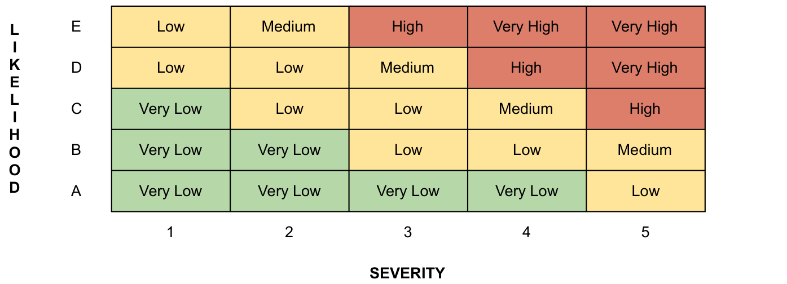

   Combination of severity and likelihood.

System Risks
~~~~~~~~~~~~

.. _fig:risks-system:

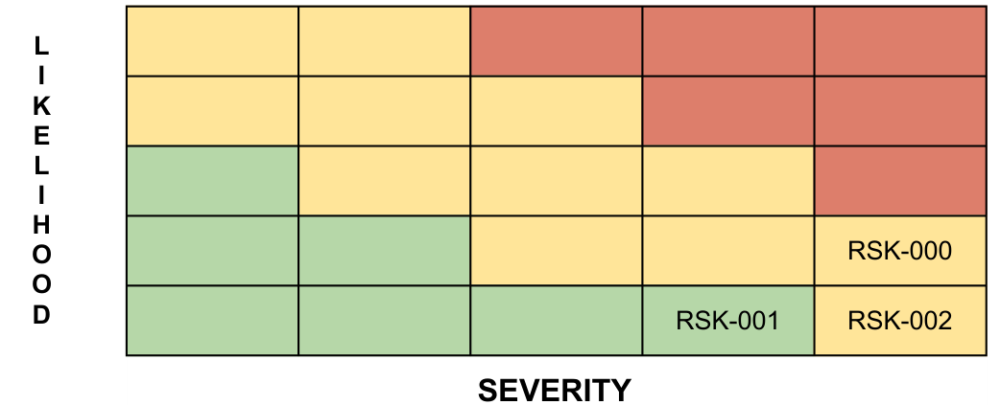

   System Risks matrix (severity × likelihood).

.. _tab:risks-system:

.. list-table:: System Risks.
   :header-rows: 1
   :widths: 22 8 35 30 10

   * - ID
     - Trend
     - Risk
     - Mitigation Strategy
     - Approach
   * - SLB-PSR-RSK-000
     - N
     - Not surviving launch environment
     - Extensive testing to launch vehicle
     - W
   * - SLB-PSR-RSK-001
     - N
     - Not surviving low orbit
     - Use space rated hardware and testing hardware specifications
     - M
   * - SLB-PSR-RSK-002
     - N
     - Not deploying from PPOD
     - Strict compliance with design and materials specifications
     - M

Comms Risks
~~~~~~~~~~~

.. _fig:risks-comms:

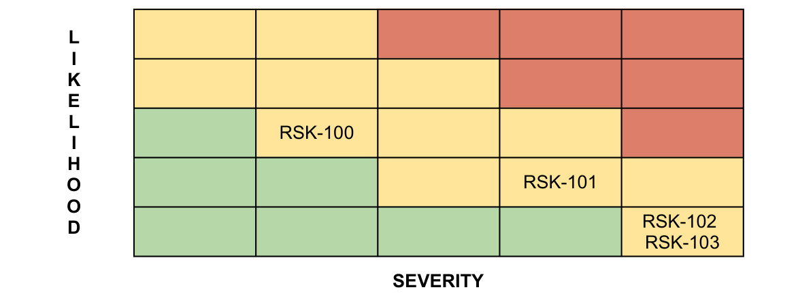

   Comms Risks matrix (severity × likelihood).

.. _tab:risks-comms:

.. list-table:: Comms Risks.
   :header-rows: 1
   :widths: 22 8 35 30 10

   * - ID
     - Trend
     - Risk
     - Mitigation strategy
     - Approach
   * - SLB-PSR-RSK-100
     - N
     - Transmit interference to GPS antenna
     - Optimal placement of transmitting antennas
     - A
   * - SLB-PSR-RSK-101
     - N
     - Antenna deployment failure
     - Increased testing of nichrome release circuit
     - M
   * - SLB-PSR-RSK-102
     - N
     - Data loss during operations
     - Partner with other ground stations, forward error correction, on board storage
     - M
   * - SLB-PSR-RSK-103
     - N
     - Power interconnect failures
     - Power tied directly to communications systems
     - M

Flight Software Risks
~~~~~~~~~~~~~~~~~~~~~

.. _fig:risks-flight-software:

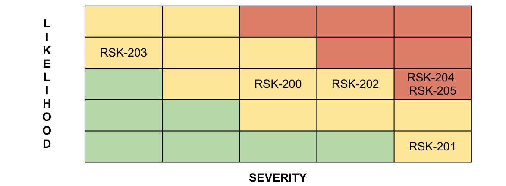

   Flight Software Risks matrix (severity × likelihood).

.. _tab:risks-flight-software:

.. list-table:: Flight Software Risks.
   :header-rows: 1
   :widths: 22 8 35 30 10

   * - ID
     - Trend
     - Risk
     - Mitigation strategy
     - Approach
   * - SLB-PSR-RSK-200
     - N
     - Radiation Effects
     - Hardened Electronics System restores/resets
     - M/A
   * - SLB-PSR-RSK-201
     - N
     - Total Ionizing Dose
     - Hardened Electronics
     - A
   * - SLB-PSR-RSK-202
     - N
     - Software Defects
     - Agile Development Strategy
     - M
   * - SLB-PSR-RSK-203
     - N
     - Documentation Defects
     - Documentation Reviews
     - A
   * - SLB-PSR-RSK-204
     - N
     - EPS software operation failure
     - Extensive testing and validation
     - M
   * - SLB-PSR-RSK-205
     - N
     - OBDH software operation failure
     - Extensive testing and validation
     - M

Ground Software Risks
~~~~~~~~~~~~~~~~~~~~~

.. _fig:risks-ground-software:

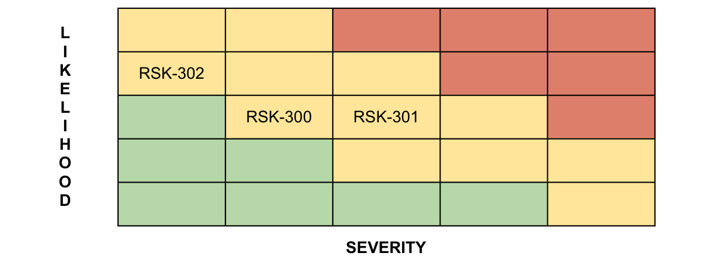

   Ground Software Risks matrix (severity × likelihood).

.. _tab:risks-ground-software:

.. list-table:: Ground Software Risks.
   :header-rows: 1
   :widths: 22 8 35 30 10

   * - ID
     - Trend
     - Risk
     - Mitigation strategy
     - Approach
   * - SLB-PSR-RSK-300
     - N
     - Bugs in schedule builder
     - QA Testing
     - A
   * - SLB-PSR-RSK-301
     - N
     - Bugs in command library
     - Hardened Electronics
     - A
   * - SLB-PSR-RSK-302
     - N
     - Documentation Defects
     - Documentation Reviews
     - A

Mission Operations Risks
~~~~~~~~~~~~~~~~~~~~~~~~

.. _fig:risks-mission-operations:

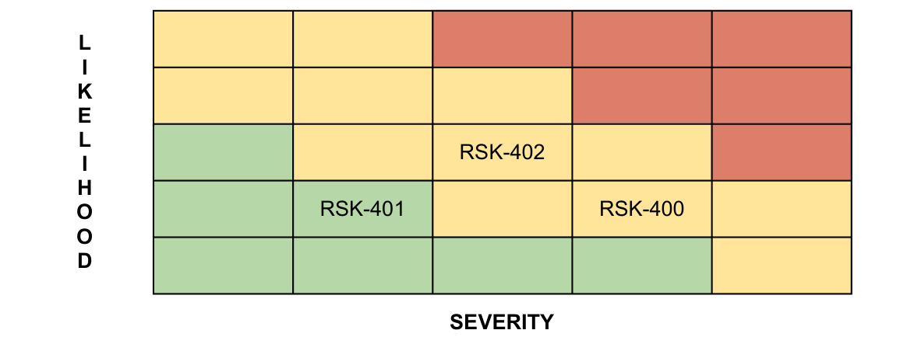

   Mission Operations Risks matrix (severity × likelihood).

.. _tab:risks-mission-operations:

.. list-table:: Mission Operations Risks.
   :header-rows: 1
   :widths: 22 8 35 30 10

   * - ID
     - Trend
     - Risk
     - Mitigation strategy
     - Approach
   * - SLB-PSR-RSK-400
     - N
     - Ground Station is not yet operational
     - Seek out backup Ground Stations
     - M
   * - SLB-PSR-RSK-401
     - N
     - Human error in command sent to cubesat
     - Checklists, script checks, keep detailed records for backtracking of issues
     - M
   * - SLB-PSR-RSK-402
     - N
     - No backup ground station
     - Other universities being contacted to serve as backup facilities if needed
     - M

EPS Risks
~~~~~~~~~

.. _fig:risks-eps:

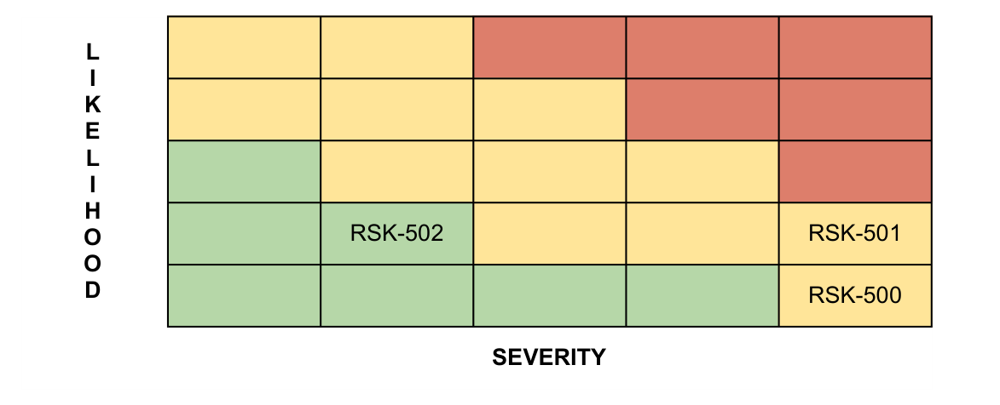

   EPS Risks matrix (severity × likelihood).

.. _tab:risks-eps:

.. list-table:: EPS Risks.
   :header-rows: 1
   :widths: 22 8 35 30 10

   * - ID
     - Trend
     - Risk
     - Mitigation strategy
     - Approach
   * - SLB-PSR-RSK-500
     - N
     - Power supply too small
     - Deployable Design
     - M
   * - SLB-PSR-RSK-501
     - N
     - Battery Malfunction
     - Stress Testing
     - M
   * - SLB-PSR-RSK-502
     - N
     - Voltage Anomaly
     - Pre-launch testing
     - W

Mechanical Risks
~~~~~~~~~~~~~~~~

.. _fig:risks-mechanical:

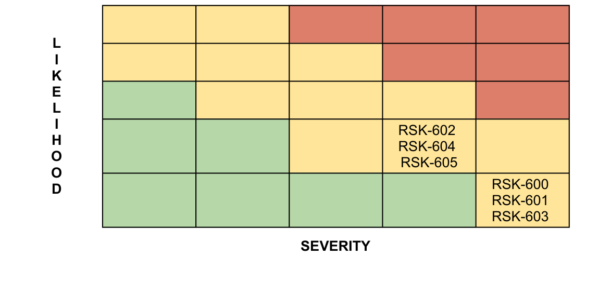

   Mechanical Risks matrix (severity × likelihood).

.. _tab:risks-mechanical:

.. list-table:: Mechanical Risks.
   :header-rows: 1
   :widths: 22 8 35 30 10

   * - ID
     - Trend
     - Risk
     - Mitigation strategy
     - Approach
   * - SLB-PSR-RSK-600
     - N
     - Structure does not survive launch
     - Extensive testing to launch vehicle specifications
     - M
   * - SLB-PSR-RSK-601
     - N
     - Kill switch does not deploy
     - Strict compliance with design and materials specification
     - M
   * - SLB-PSR-RSK-602
     - N
     - Heat transfers through structure into payload
     - Use of materials with low thermal conductivity for camera mounting
     - M
   * - SLB-PSR-RSK-603
     - N
     - Failures in the production of the structure
     - Test integration for the resolution of the issues before the final integration
     - M
   * - SLB-PSR-RSK-604
     - N
     - Total corruption between PCB comunication
     - Perform tests during the integration
     - M
   * - SLB-PSR-RSK-605
     - N
     - Vibration test invalidated
     - Apply epoxi at the parts of the structure with issues, then take the test again.
     - M

Thermal Risks
~~~~~~~~~~~~~

.. _fig:risks-thermal:

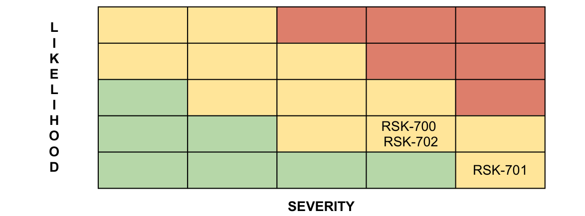

   Thermal Risks matrix (severity × likelihood).

.. _tab:risks-thermal:

.. list-table:: Thermal Risks.
   :header-rows: 1
   :widths: 22 8 35 30 10

   * - ID
     - Trend
     - Risk
     - Mitigation strategy
     - Approach
   * - SLB-PSR-RSK-700
     - N
     - Temperature sensors of components stop working
     - Extensive testing to launch vehicle specifications
     - W, R
   * - SLB-PSR-RSK-701
     - N
     - Components reach or exceed survival temperatures
     - Thermal Insulation/radiators
     - M, R
   * - SLB-PSR-RSK-702
     - N
     - Thermal tests invalidated
     - Apply new thermal insulations for the high temperature or research for another type of solution
     - M, R

Schedule Risks
~~~~~~~~~~~~~~

.. _fig:risks-schedule:

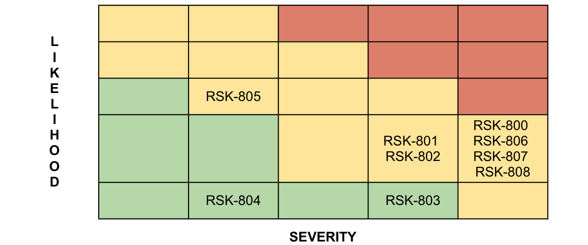

   Schedule Risks matrix (severity × likelihood).

.. _tab:risks-schedule:

.. list-table:: Schedule Risks.
   :header-rows: 1
   :widths: 22 8 35 30 10

   * - ID
     - Trend
     - Risk
     - Mitigation strategy
     - Approach
   * - SLB-PSR-RSK-800
     - N
     - Hardware does not interface as expected
     - Starting integration early with FlatSat development
     - W
   * - SLB-PSR-RSK-801
     - N
     - Purchased flight hardware breaks during integration
     - Careful procedure development and documentation, filtering through systems engineering
     - M
   * - SLB-PSR-RSK-802
     - N
     - Environmental testing causes component failure
     - Thermal and structural analysis, carefully documented procedures, guidance from experts
     - M
   * - SLB-PSR-RSK-803
     - N
     - The SpaceLab ground station may not become operational in time for the mission’s launch
     - Assemble software team to build ground station software, collaborate with other universities
     - M
   * - SLB-PSR-RSK-804
     - N
     - Limited facility availability
     - Work closely with facility managers to maintain schedule
     - W
   * - SLB-PSR-RSK-805
     - N
     - Team turnover can lead to rework of some tasks
     - Offering a Master's degree to the undergraduate team
     - M
   * - SLB-PSR-RSK-806
     - N
     - Delays in the supply of the FPGA for the OBDH Ultra can either make its usage unfeasible or lead to mission delays.
     - Check the possibility of anticipating procurement of FPGA
     - W
   * - SLB-PSR-RSK-807
     - N
     - Issues in the RE²PS project can cause delays in development and, consequently, in the satellite’s launch
     - 
     - W
   * - SLB-PSR-RSK-808
     - N
     - The payload communication module may not be ready in time for the launch
     - 
     - W

Cost Risks
~~~~~~~~~~

.. _fig:risks-cost:

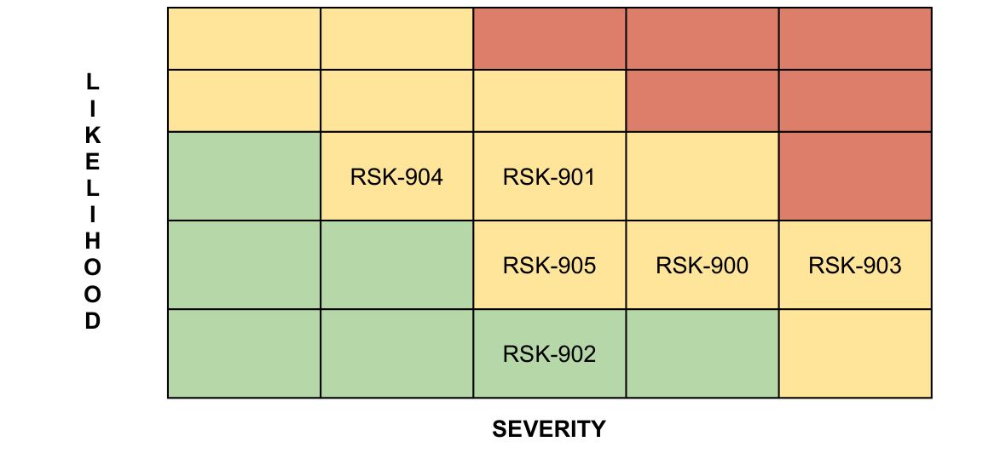

   Cost Risks matrix (severity × likelihood).

.. _tab:risks-cost:

.. list-table:: Cost Risks.
   :header-rows: 1
   :widths: 22 8 35 30 10

   * - ID
     - Trend
     - Risk
     - Mitigation strategy
     - Approach
   * - SLB-PSR-RSK-900
     - N
     - Purchased hardware does not meet interface requirements
     - Aid from industry
     - M
   * - SLB-PSR-RSK-901
     - N
     - Purchased flight hardware breaks
     - Engineering models will be identical to the flight models, and could potentially be used
     - M
   * - SLB-PSR-RSK-902
     - N
     - Actual costs are greater than projected costs
     - Acquired component quotes, seek guidance from experts
     - M
   * - SLB-PSR-RSK-903
     - N
     - Unable to obtain additional financial resources to complete the mission (operational phase and launch)
     - Advertising to show the importance of the mission; try cooperation agreements for launch; find future financial resources
     - M
   * - SLB-PSR-RSK-904
     - N
     - Materials resources not sufficient for preliminary tests
     - Check the possibility of anticipating procurement of critical components and require changes in the designs, leading to delays accordingly.
     - W
   * - SLB-PSR-RSK-905
     - N
     - COTS systems not available for purchase
     - Check the possibility of anticipating procurement of critical components and require changes in the designs, leading to delays accordingly.
     - M

External Risks
~~~~~~~~~~~~~~

.. _fig:risks-external:

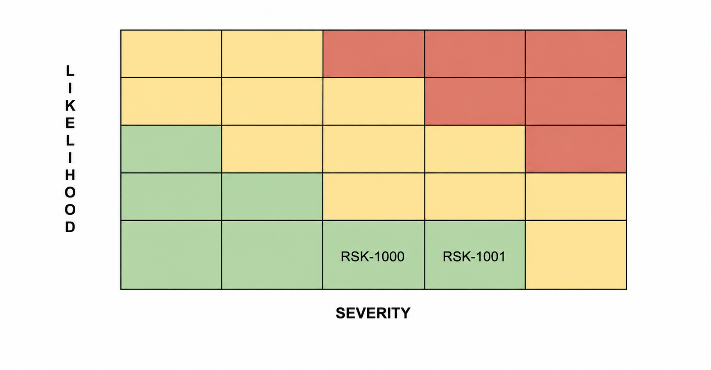

   External Risks matrix (severity × likelihood).

.. _tab:risks-external:

.. list-table:: External Risks.
   :header-rows: 1
   :widths: 22 8 35 30 10

   * - ID
     - Trend
     - Risk
     - Mitigation strategy
     - Approach
   * - SLB-PSR-RSK-1000
     - N
     - LIT availability for satellite qualification tests
     - Reserve test dates in advance
     - M
   * - SLB-PSR-RSK-1001
     - N
     - Operational licensing not available on launch time
     - Start ANATEL process ASAP
     - M

Mitigation Plan
===============

:red:`TBD`
