.. subsystems.rst

    Copyright The Persistent-1 Contributors.

    Persistent-1 Documentation

    This work is licensed under the Creative Commons Attribution-ShareAlike 4.0
    International License. To view a copy of this license,
    visit http://creativecommons.org/licenses/by-sa/4.0/.

.. _ch:subsystems:

**********
Subsystems
**********

This chapter describes all the subsystems of the space segment of the mission. Most of the subsystems presented here have their own technical documentation with a more exhaustive description. Where available, reference is made to the respective document. The aim of this chapter is to provide a high-level overview of each subsystem within the broader scope of the mission, presenting the two main sectors: the service sector and the payload sector.

1U Sector
=========

On-Board Data Handling
----------------------

The *OBDH* 2.0 is an *OBC* module designed for nanosatellites. The module is responsible for synchronizing actions and the data flow between other modules (i.e., power module, communication module, payloads) and the Earth segment. It packs the generated data into data frames and transmits back to Earth through a communication module or stores it on non-volatile memory for later retrieval. Commands sent from Earth segment to CubeSat are received by radio transceivers in the communication module and redirected to the *OBDH*, which takes the appropriate action or forwards the commands to the target module.

The module is a direct upgrade from the *OBDH* of FloripaSat-1 :cite:`floripasat`, which grants a flight heritage rating. The improvements focus on providing a cleaner and more generic implementation than the previous version, more reliability in software and hardware implementations, and adaptations for the new mission requirements. The module board can be seen in :numref:`fig:obdh2`.

.. _fig:obdh2:

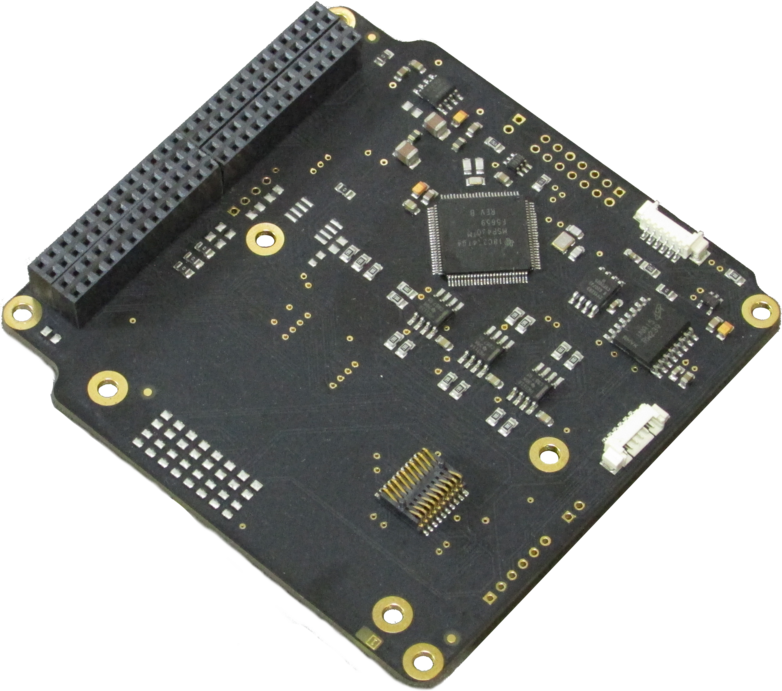

   *OBDH* module.

More information about this module can be found in :cite:`obdh2`.

Telemetry, Tracking and Command Module
--------------------------------------

The *TTC* (or TT&C) is responsible for making the communication between Earth (a ground station) and the satellite and is divided into two sub-modules: Beacon and downlink/uplink. The beacon is an independent sub-module that transmits a periodic signal containing satellite *ID* and some basic telemetry data. The downlink/uplink sub-module is the primary communication device. It has a bidirectional data link to receive telecommands from the Earth and transmit all available data back to Earth. The module board can be seen in :numref:`fig:ttc`. More information about this module can be found in :cite:`ttc`.

.. _fig:ttc:

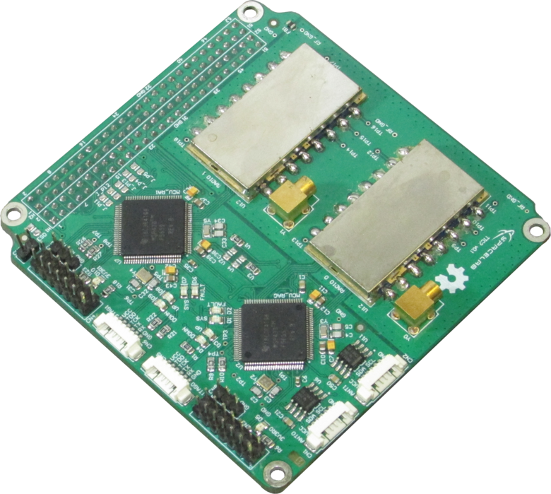

   *TTC* module.

Antenna Module
~~~~~~~~~~~~~~

The antenna module used is the CubeSat deployable *VHF* and *UHF* antenna from ISISpace :cite:`isis-antenna`. It is a four-monopole antenna built with tape strings (up to 55 cm) and compliant with the CubeSat standard. It can be also configured as dipole or turnstile type antenna. The deployment method is the burn wire, which can be controlled digitally through a I²C interface. To allow redundancy, two independent deployment controllers can be activated separately. Furthermore, the construction of this module allows the installation of a solar panel on the top side. The RF gain is about 0 dBi. A picture of the antenna module (with all the antennas released) can be seen in :numref:`fig:isis-antenna`.

.. _fig:isis-antenna:

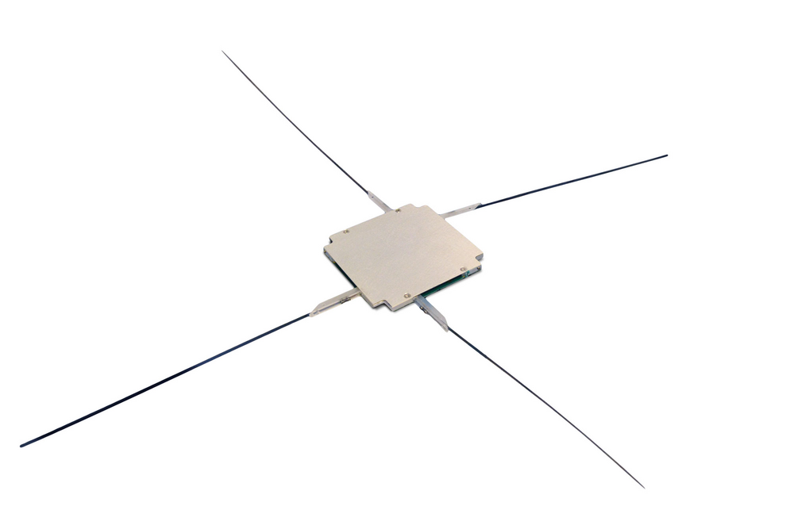

   Antenna module from ISISpace.

For this mission, two antenna modules will be used. The chosen can be seen in :numref:`tab:antennae-config` (using :numref:`fig:isis-antenna-ref` as reference):

.. _tab:antennae-config:

.. list-table:: Antenna configuration.
   :header-rows: 1

   * - **Parameter**
     - **Antenna 1**
     - **Antenna 2**
   * - Configuration
     - Turnstile
     - Turnstile
   * - Frequency
     - :red:`TBD`
     - :red:`TBD`
   * - Tunning structure size
     - :red:`TBD`
     - :red:`TBD`
   * - Mounting position
     - Top
     - Bottom
   * - Supply voltage
     - 3.3 V
     - 3.3 V
   * - I²C control type
     - Dual bus
     - Dual bus
   * - I²C watchdog
     - Enabled (60 sec timeout)
     - Enabled (60 sec timeout)

.. _fig:isis-antenna-ref:

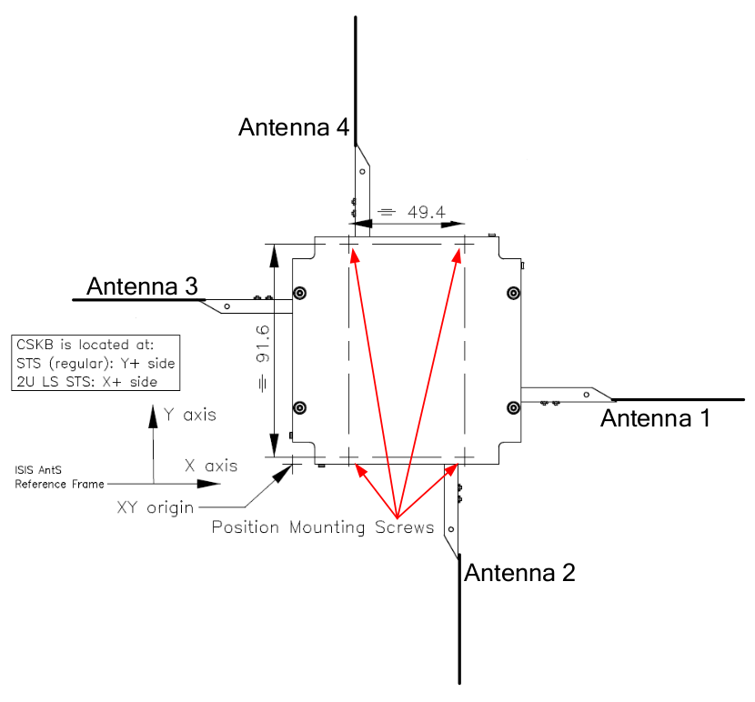

   Configuration reference of the antenna module.

A temperature sensor and the state of four deployment switches (1 per monopole) are also available in the digital interface. These switches indicate if a monopole is released or not, and can be used as feedback of the deployment process.

Electrical Power System
-----------------------

The *EPS* is the module designed to harvest, store and distribute energy for the satellite. The energy harvesting system is based on solar energy conversion through the solar panels attached to the CubeSat structure. The *EPS* is designed to operate the solar panels at their *MPP*. The board also measures the solar panels current, voltage and temperature of the batteries. The solar energy harvested is stored in a battery module connected to the *EPS*. Several integrated buck DC-DC converters do the energy distribution. The full *EPS* system is composed of the solar panels, the *EPS* PCB and the battery module. A general view of the *EPS* board can be seen in :numref:`fig:eps2`.

.. _fig:eps2:

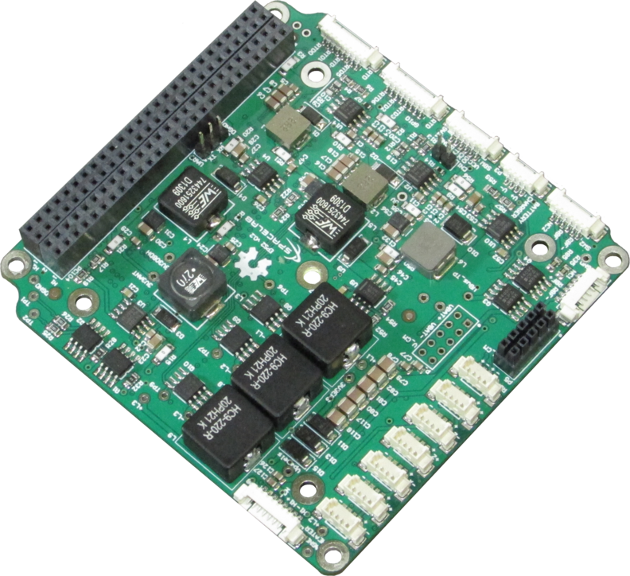

   *EPS* module.

The module is a direct upgrade from the *EPS* of FloripaSat-1 :cite:`floripasat`, which grants a flight heritage rating. The improvements focus on providing a cleaner and more generic implementation compared to the previous version, more reliability in software, and adaptations for the new mission requirements. More information about this module can be found in :cite:`eps2`.

.. _ssec:battery-module:

Battery Module
~~~~~~~~~~~~~~

The battery module used is the *BAT4C*, which is a separate battery module from the *EPS* board and composed by four lithium-ion 18650 cells. Besides the cells, the board has connectors for interfacing signals and power lines with the *EPS* module, 2 power resistors to operate as heaters to maintain the cell's temperature during eclipse periods, and 4 temperature sensors. The batteries used are the ICR18650-30B lithium-ion cells from Samsung :cite:`icr18650-30b`, which are connected in series and parallel (two sets of two parallel cells in series) to supply the required voltage and current. Each cell is fixed with 18650 metal holders, and between the pairs, the power resistor is attached with a thermal element in the middle. A mechanical mount is placed over the batteries and screwed to the board, providing better stress resistance. Also, PC-104 through-hole pads are present on the board for a connector that could be used for mechanical integration with the *EPS*, or, with future improvements, an interface for power, data or control signals. The board is a direct improvement from the first battery board used in the FloripaSat-1 mission :cite:`floripasat`. More information about the battery module can be found in :cite:`bat4c`.

.. _fig:battery-module-board:

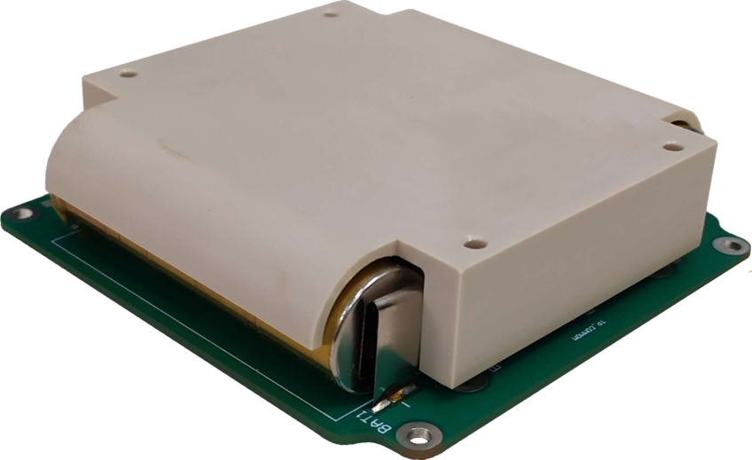

   Battery module board.

Interconnection Between 1U Modules
----------------------------------

PC-104 Interconnection Boards
~~~~~~~~~~~~~~~~~~~~~~~~~~~~~

The PC-104 interconnection boards are intended to be used to interconnect the service monitoring modules. This interconnection is made with PC-104 and PicoBlades cables.

.. _fig:pc104-adapter:

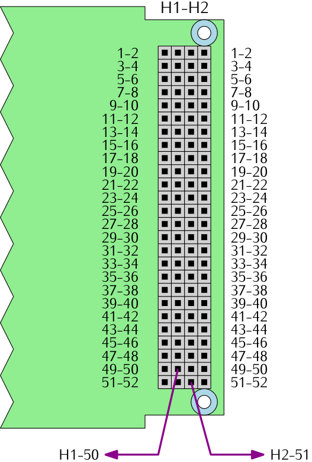

   PC-104 schematic.

More information about these boards can be found in :cite:`pc104-boards`.

External Connection Boards
~~~~~~~~~~~~~~~~~~~~~~~~~~

The *IIP* are three vertical internally mounted PCBs designed to give external access to up to four modules inside of CubeSat during final *AIT* before launch. The complete set of boards allows the nanosatellite to be charged, programmed, and debugged. The usage of this hardware platform takes into account the use of a MSP-FET: MSP430 Flash Emulation Tool from Texas Instruments for JTAG programming and debugging, UART debugging through a mini USB type B port interfacing the FT4232H USB bridge IC from FTDI, a JST XH header for charging internal batteries and a *RBF* pin header. The boards can be seen in :numref:`fig:iip-boards`.

.. _fig:iip-boards:

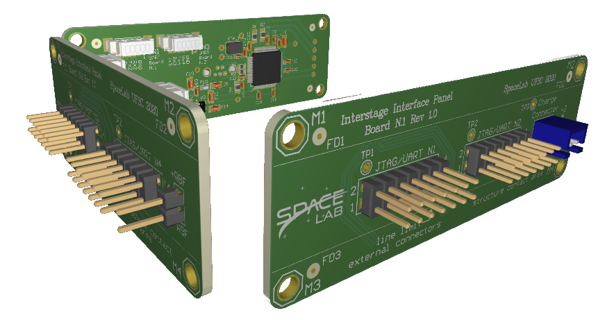

   Set of external connection boards.

For this mission, the four JTAG connectors are being used as described in :numref:`tab:iip-jtag-usage`.

.. _tab:iip-jtag-usage:

.. list-table:: IIP JTAG connectors usage.
   :header-rows: 1

   * - **JTAG Connector**
     - **Connected Module**
   * - JTAG/UART N1
     - *OBDH*
   * - JTAG/UART N2
     - *EPS*
   * - JTAG/UART N3
     - *TTC*
   * - JTAG/UART N4
     - None

More information about these boards can be found in :cite:`iip`.

Thermal Control
---------------

To ensure optimal thermal regulation, an active control system has been implemented, comprising two 24 :math:`\Omega` resistors to safeguard the batteries against low temperatures, along with four RTD for precise temperature monitoring, as depicted in :numref:`fig:heaters`. The control mechanism operates on an ON/OFF basis.

.. _fig:heaters:

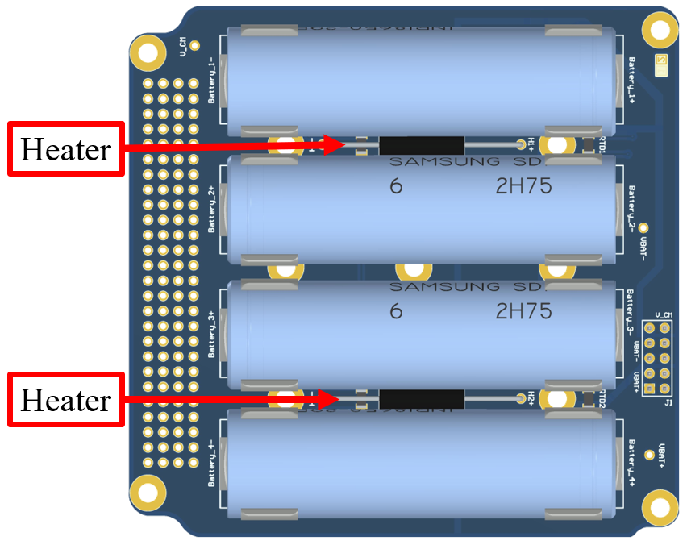

   Representation of the positioning of the heaters on the battery plate.

2U Sector
=========

This sector is responsible for holding and maintaining the modules for the payload, with the Persistent-1 mission designed to incorporate the RE²PS as its main payload. In addition, a second payload, SLCAM, will be used to carry out a specific experiment at SpaceLab, focusing on the application of the satellite in *images* contexts. The other payloads are *TMTC 3.0* and *EDC*.

Environmental Data Collection
-----------------------------

The Environmental Data Collection *EDC* is a CubeSat-compatible payload that decodes signals from Platform Transmitter Terminals (PTTs) belonging to the *SBCD* and the Argos-2 System.

The main features of this payload are listed below, a 3D model of the *EDC* board can be seen in :numref:`fig:edc-board`.

* Reception/decoding of *SBCD* and Argos-2 signals on the 401.635 MHz ± 30 kHz frequency range.

* Can decode up to 12 PTT signals simultaneously.

* Attaches a header to decoded messages with frequency, time, and signal strength information.

* Full speed I²C interface (400 kbit/s) for the OBC communication.

* Full-duplex RS-485 interface with fail-safe for the OBC communication.

* 5 V power supply.

* Memory capable of storing up to 64 decoded user messages.

* Generates housekeeping information, including current supply, board temperature, digitized signal RMS level, front-end PLL synchronism state, and overcurrent events.

* Can capture a 2048 sample sequence (16 ms window) from the received signal upon request.

.. _fig:edc-board:

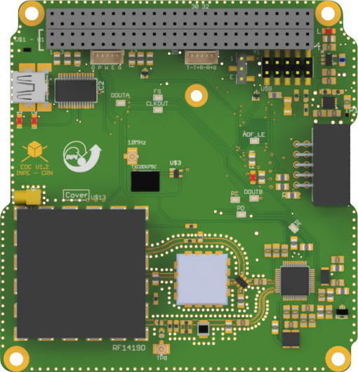

   *EDC* board.

SLCAM
-----

SLCam\ :cite:`slcam` (SpaceLab Camera) is a camera payload developed by SpaceLab at the Federal University of Santa Catarina (UFSC). Designed for integration into small satellites, particularly CubeSats, its primary objective is to capture images of Earth from space.

The camera is equipped with an RGB sensor and offers a maximum resolution of 1600 x 1200 pixels, a 68-degree field of view, and utilizes a 6mm focal length lens with an IR filter. The core of the camera module is the Arducam Mini 2MP Plus, which features an OV2640 image sensor. The SLCam is controlled by an STM32F103C8T6 microcontroller, an ARM Cortex M3 model, and communicates with other devices through SPI, I2C, UART, and CAN interfaces. It includes 16 MB of flash memory for storage and operates with a power supply of 3.3V at 140 mA. The camera's dimensions are 92.30 mm x 77.43 mm, aligning with the CubeSat standard.

The project also encompasses the development of software for testing and validating the camera module. This software, written in Python, enables sending commands to the camera, reading images, and facilitating communication between a PC and the camera module through USB/SPI or USB/CAN converters. The PCB of the SLCAM payload can be seen in :numref:`fig:slcam-board1` and :numref:`fig:slcam-board2`. A picture of the SLCAM payload can be seen in :numref:`fig:slcam`.

.. _fig:slcam-board1:

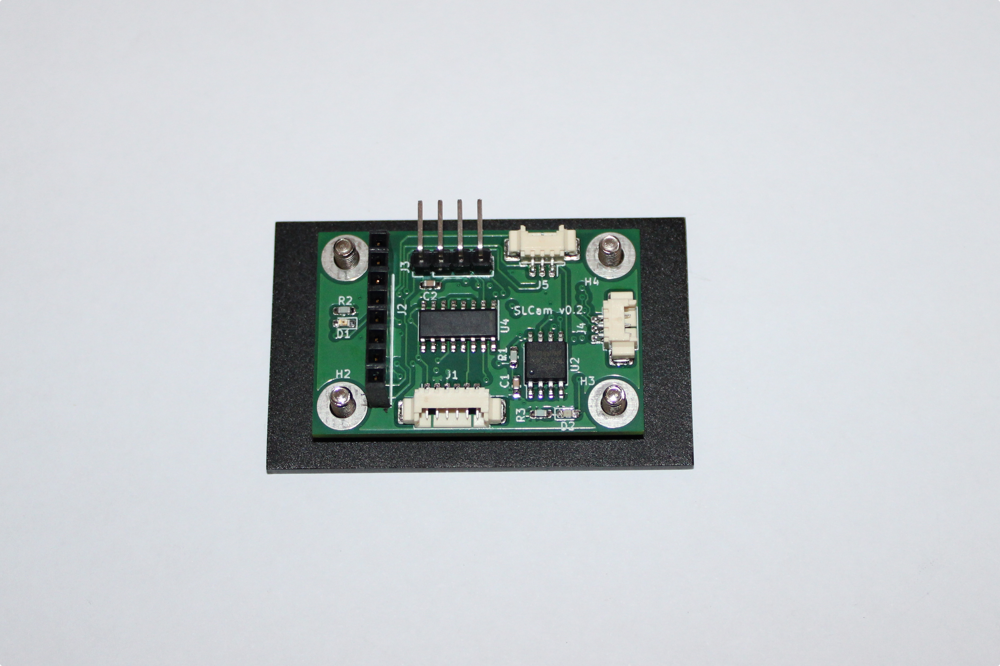

   SLCAM board (view 1).

.. _fig:slcam-board2:

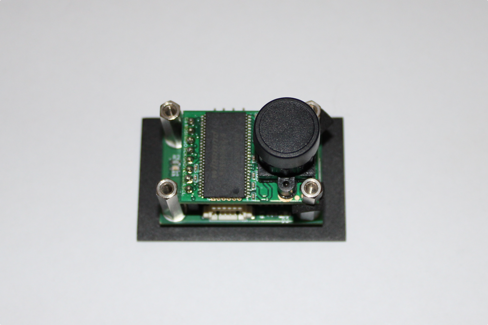

   SLCAM board (view 2).

.. _fig:slcam:

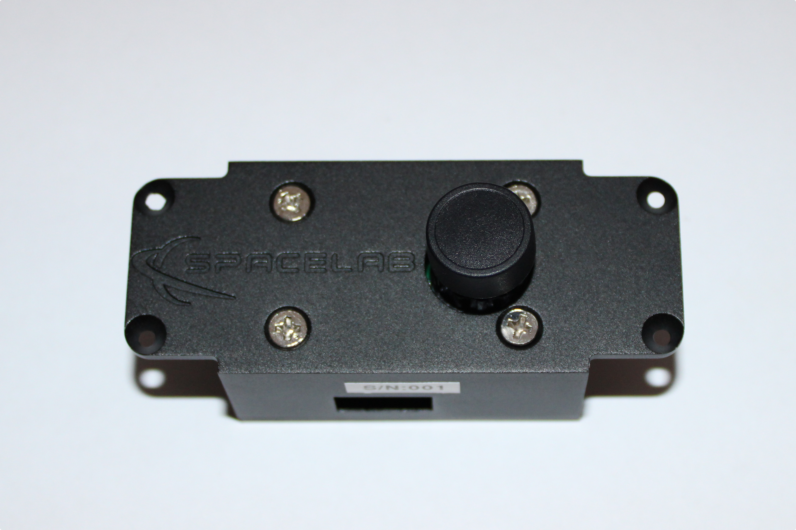

   SLCAM payload.

On-Board Data Handling - 2U
---------------------------

Due to issues in the acquisition of the Reliability Enhanced On-Board Data Handling board module, an OBDH 2.0 will be used as a payload for the mission. The options considered for the now-deprecated REOBDH idea included Payload-ULTRA\ :cite:`ultra` and OBDH 3.0, which are in the development phase. To better comply with the requirements for the mission, the use of an OBDH 2.0 was selected as a substitute for hardware and firmware, since a previously-tested module improves development quality and eases debugging efforts. Moreover, a daughterboard can be used as a communication interface between the OBDH and the RE²PS via GPIOs and ADC readings. More information about OBDH 2.0 and its functionality can be found in its official documentation\ :cite:`obdh2`, as well as in the 1U section of this document.

TMTC 3.0
--------

The development of a telecommand and telemetry module (TMTC 3.0)\ :cite:`tmtc` for CubeSats is underway. This module is being designed based on an analysis of existing TMTC architectures, including SpaceLab's TTC 2.0 and other commercial solutions. The design prioritizes versatility and reliability, incorporating multiple communication interfaces and adhering to established standards. A comprehensive set of requirements has been defined to guide the development process, and a modular architecture has been adopted for flexibility.

Reliability Enhanced Electrical Power System
--------------------------------------------

The RE²PS\ :cite:`re2ps` is an electrical power system designed for CubeSat nanosatellites, with a focus on improved reliability and robustness. It differs from the EPS2, another power system, in several key aspects:

* **Power Management:** The RE²PS utilizes an integrated circuit (BQ24650) to manage solar energy harvesting and battery charging, while the EPS2 has a separate battery management system and a heating system.

* **Power Conversion:** The RE²PS has only two DC-DC converters (with redundancies) to distribute power across six buses, whereas the EPS2 has multiple dedicated DC-DC converters for different output voltages.

* **Redundancy:** The RE²PS incorporates redundancies in key components to enhance reliability, a feature not present in the EPS2.

* **Battery Monitoring:** The RE²PS lacks a dedicated battery monitoring system like the EPS2, but the BQ24650 offers some battery protection features.

* **Battery Heating:** The RE²PS does not include a battery heating system like the EPS2.

In summary, the RE²PS prioritizes simplicity, reliability, and robustness by eliminating extra components and systems in favor of redundancies and an efficient integrated power management circuit. This approach aims to ensure reliable power delivery for nanosatellites in space missions, even under challenging conditions. RE²PS is currently being tested and improved, and its first version has already been manufactured. The PCB of the RE²PS payload can be seen in :numref:`fig:re2ps-top` and :numref:`fig:re2ps-bottom`.

.. _fig:re2ps-bottom:

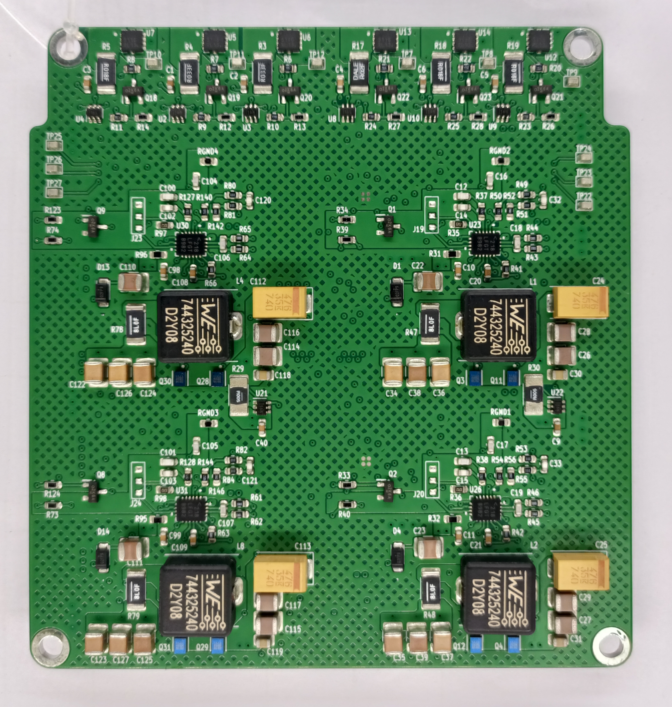

   RE²PS bottom board.

.. _fig:re2ps-top:

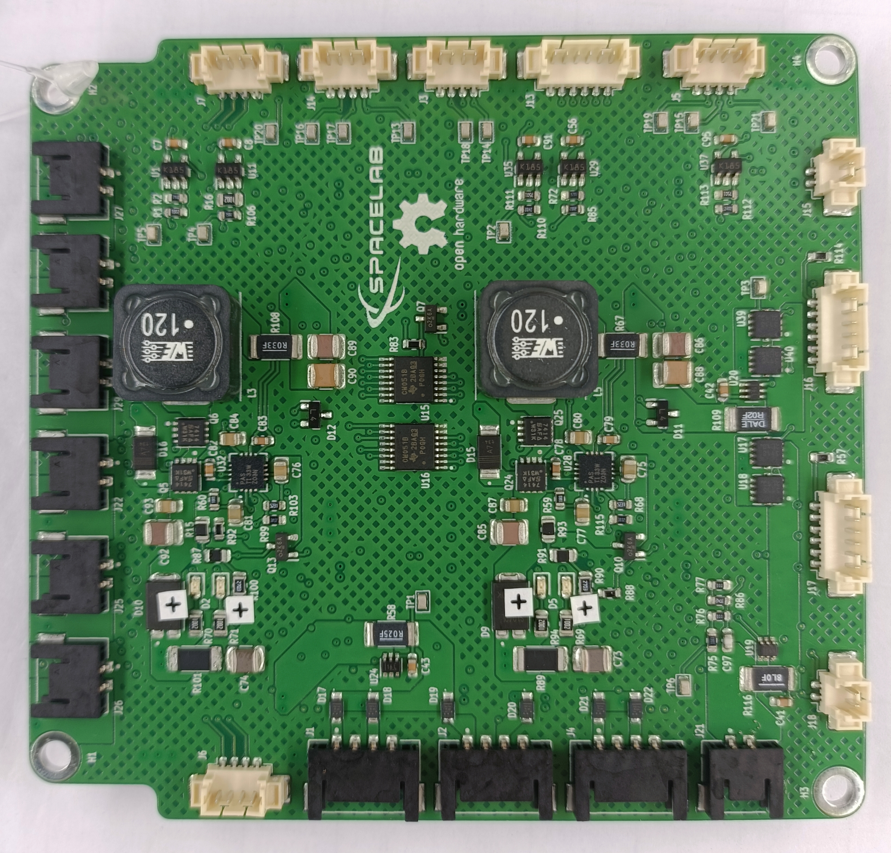

   RE²PS top board.

.. _ssec:battery-module-2u:

Battery Module
~~~~~~~~~~~~~~

The battery module used is the *BAT4C*, which is a separate battery module from the *RE²PS* board and composed by four lithium-ion 18650 cells. Besides the cells, the board has connectors for interfacing signals and power lines with the *RE²PS* module, 2 power resistors to operate as heaters to maintain the cell's temperature during eclipse periods, and 4 temperature sensors. The batteries used are the ICR18650-30B lithium-ion cells from Samsung :cite:`icr18650-30b`, which are connected in series and parallel (two sets of two parallel cells in series) to supply the required voltage and current. Each cell is fixed with 18650 metal holders, and between the pairs, the power resistor is attached with a thermal element in the middle. A mechanical mount is placed over the batteries and screwed to the board, providing better stress resistance. Also, PC-104 through-hole pads are present on the board for a connector that could be used for mechanical integration with the *RE²PS*, or, with future improvements, an interface for power, data or control signals. The board is a direct improvement from the first battery board used in the FloripaSat-1 mission :cite:`floripasat`. More information about the battery module can be found in :cite:`bat4c`.

Interconnection Between 2U Modules
----------------------------------

PicoLocks
~~~~~~~~~

The PicoLocks interconnection boards are intended to be used to interconnect the payload modules.

Thermal Control
---------------

To ensure optimal thermal regulation, an active control system has been implemented, comprising two 24 :math:`\Omega` resistors to safeguard the batteries against low temperatures, along with four RTD for precise temperature monitoring, as depicted in :numref:`fig:heaters`. The control mechanism operates on an ON/OFF basis.

Satellite Structure
===================

Solar Panels
------------

The solar panels are a set of 10 custom-made panels manufactured by Orbital Engenharia, a Brazilian company. The panels feature protection diodes and high-efficiency solar cells, which are the CESI's CTJ-30 :cite:`ctj30` with dimensions 6.9 × 3.9 cm (area 26.5 cm²). This cell is qualified for space use by ESA with an efficiency of 29.5 % (AM0, BOL). The panels do not include magnetometers, sensors, and other devices. A picture of the complete set solar panels can be seen in :numref:`fig:solar-panel-orbital`.

.. _fig:solar-panel-orbital:

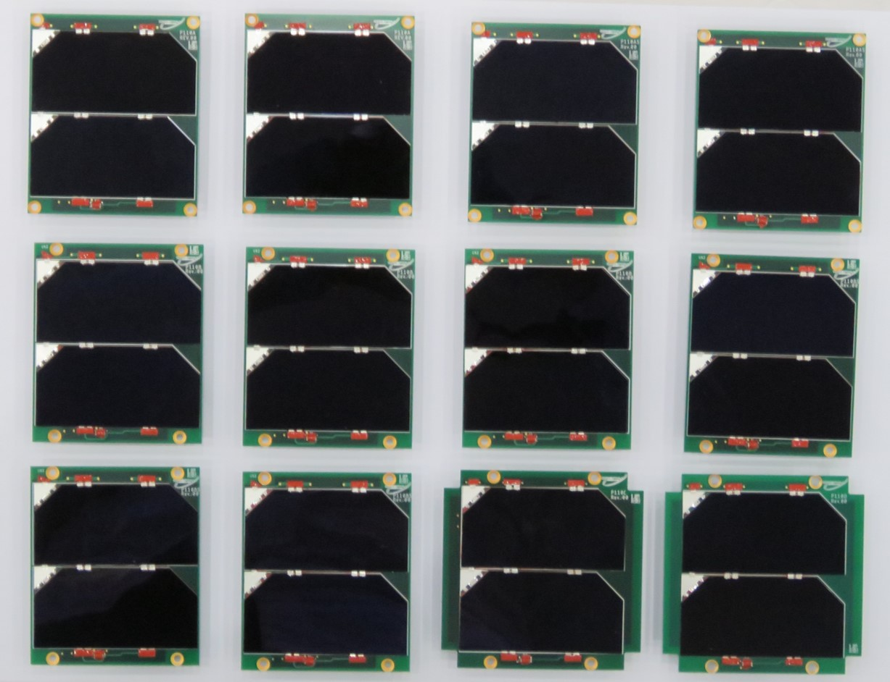

   Solar panels.

Kill-Switches and RBF
---------------------

Two electronic switches have been implemented into the design to allow for the (redundant) deployment detection of the CubeSat when deployed from the POD. This electronic micro switch can be used to prevent the satellite from starting up during launch, as is required for all CubeSat launches and hence acts as a Kill-Switch. The Kill-Switch is the Panasonic AV4 microswitch (AV402461), as seen in :numref:`fig:av402461`.

.. _fig:av402461:

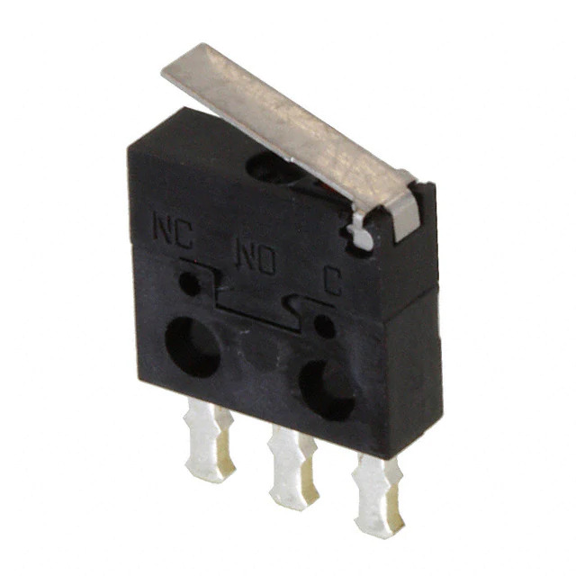

   Panasonic AV402461 Microswitch.

The Kill-Switch mechanism in the mechanical structure has combined the function of providing deployment and detection (:numref:`fig:kill-switch-installed`). The travel of the actual switch of the Kill-Switch itself is so short that the Kill-Switch could “detect deployment” of the CubeSat from the launch adapter simply due to launch vibrations. To overcome this issue the Kill-Switch has been rotated so that there is a positive obstruction in front of the switch which needs 8 mm of deployment before deployment can be detected with the Kill-Switch. In :numref:`fig:kill-switch-installed` the Kill-Switch parts are highlighted, and the stowed and deployed configuration is shown.

.. _fig:kill-switch-installed:

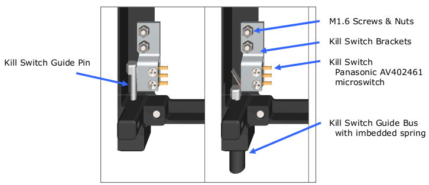

   Kill-Switches installed in the mechanical structure.

The contact arrangement of the microswitch and the current rating are detailed in :numref:`fig:circuit-kill-switch` and :numref:`tab:kill-switch-specs`.

.. _fig:circuit-kill-switch:

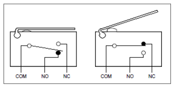

   The contact arrangement of the microswitch.

.. _tab:kill-switch-specs:

.. list-table:: Kill-Switch current rating and voltage range.
   :header-rows: 1

   * - **Characteristic**
     - **Minimum**
     - **Typical**
     - **Maximum**
     - **Unit**
   * - Switch Current
     - 2
     - 50
     - 100
     - mA
   * - DC Voltage across switch contacts
     - n/a
     - n/a
     - 30
     - V
   * - Contact resistance microswitch
     - n/a
     - n/a
     - 200
     - m\ :math:`\Omega`

Attitude Control System
-----------------------

The *ACS* is a passive attitude control system, which depends on the Earth's magnetic field to rotate and stabilize the satellite :cite:`santoni2009,gerhardt2010`. The system is composed of one permanent magnet to create a force to align the magnet with the Earth's magnetic field and four hysteresis bars to dampen the cube oscillations and achieve stabilization.

When equilibrium is achieved, the permanent magnet aligns with the Earth's field lines. The hysteresis bars convert oscillation and rotation energy into heat, maintaining the alignment through the magnetic moment. The components are placed in positions to minimize the magnet's interaction with the hysteresis bars, which limits the magnetic moment of the magnet :cite:`francois2010`. The whole passive *ACS* was implemented according to :cite:`francois2010`.

As a passive magnetic attitude control system is used, it is possible to stabilize only one axis. So, the CubeSat will still slowly (due to hysteresis bars) rotate around this axis, even after stabilized. A N45 neodymium magnet and 4 hysteresis bars of Permanorm 5000 H2 are used (courtesy of Vacuumschmelze GmbH & Co. KG). The hysteresis bar's material is shaped to maximize stabilization, which is the most critical part of attitude control.

Many conditions impact the detumbling time, which is the time required for the satellite to stabilize. Magnetic passive attitude stabilization systems such as the one developed for this mission achieve the equilibrium state within a few weeks of operation :cite:`santoni2009`.

The Persistent-1 satellite does not feature an orbit control subsystem.

Mechanical Structure
--------------------

The USIPED 3-Unit CubeSat structure is developed as a generic, modular satellite structure based on the CubeSat standard. The modular chassis allows up to two 1-Unit stack of PCBs, or other modules, to be mounted inside the chassis, using the PC-104 standard and spacers attached to the structure. In addition, there are 4 slots in the middle section, providing space for the interface boards and the *ACS*. The solar panels and antennas are externally mounted, providing a complete mechanical solution.

The structure will support the loads and vibration along the entire life cycle of the satellite, which includes every phase prior to the launch, the launch itself, and the operation of the CubeSat in space. In addition, the structure must keep all the parts of the CubeSat fastened at the proper position during the launch and operation, provide a conductive thermal path for heat transfer, and provide access for assembly, integration, and verification.

The material of all its parts is aluminum T6065, except for the bolts and thread. This material presents good mechanical properties for space application, such as weight, strength, fracture and fatigue resistance, thermal expansion, and ease of manufacturing. The surfaces of the CubeSat in contact with the deployer are anodized and grounded for proper and smooth ejection. The main views of the assembled structure is presented in :numref:`fig:structure_views`, as well as its main dimensions.

.. _fig:structure_views:

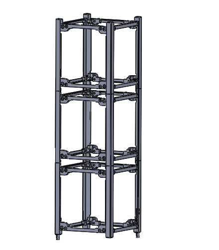

   Views and main dimension of the structure.
